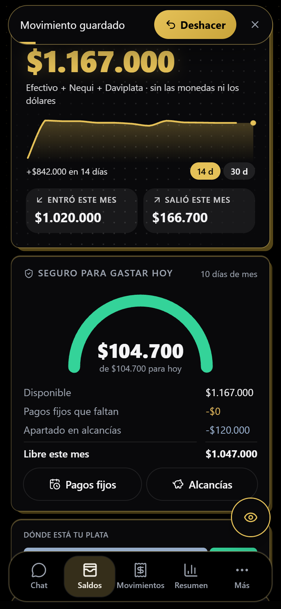
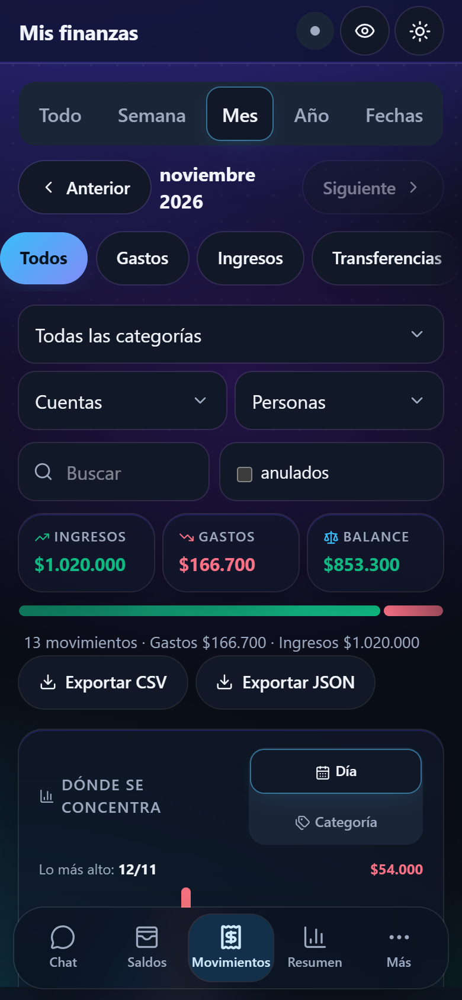
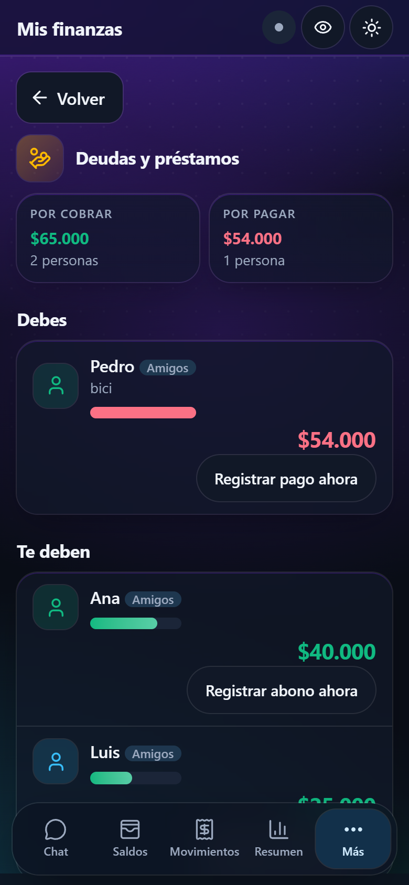
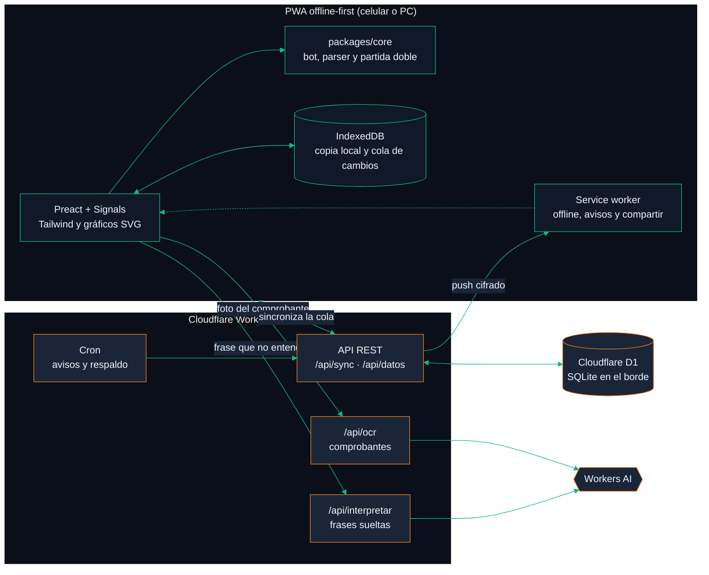

<div align="center">



<br />

**Escribes lo que pasó. El bot muestra lo que entendió. Tú confirmas y todo cuadra.**
Una app de finanzas personales y de negocio con partida doble, sin conexión y gratis sobre Cloudflare.

<br />

[**Qué hace**](#qué-hace) &nbsp;·&nbsp; [**Chat**](#qué-puedes-escribirle-al-chat) &nbsp;·&nbsp; [**Capturas**](#capturas) &nbsp;·&nbsp; [**Arquitectura**](#arquitectura) &nbsp;·&nbsp; [**Estructura**](#estructura-del-monorepo) &nbsp;·&nbsp; [**Despliegue**](#despliegue-en-3-pasos) &nbsp;·&nbsp; [**Docs**](docs/README.md)

<br />

**Frontend y PWA**<br />


**Backend en el borde y base de datos**<br />


**IA y herramientas**<br />


<br />


</div>

---

## Qué hace

| | |
|---|---|
| **Contabilidad** | Gastos, ingresos, préstamos, deudas, pagos y gastos compartidos con partida doble: cada movimiento suma cero o no se guarda. Efectivo con billetes, monedas y vuelto. |
| **Saldos** | Disponible con la curva de los últimos días, liquidez contra deudas y el widget "seguro para gastar hoy". |
| **Movimientos** | Filtros, gráfico de dónde se concentra el gasto, foto del recibo, lectura con IA y tarjeta para compartir por WhatsApp. |
| **Resumen** | Dona interactiva, ritmo de gasto contra el mes anterior, topes y gastos hormiga. |
| **Planear** | Alcancías con fecha estimada de cumplimiento y pagos fijos con aviso antes del cobro. |
| **Comprobantes** | Una foto de Nequi, Daviplata o una tirilla, leída con IA con visión. Llega como una tarjeta lista para confirmar. |
| **Revisión del mes** | Nota de salud y hallazgos con botones que llevan directo a donde se arreglan. |
| **Sin conexión** | Todo se guarda en el celular y se sincroniza al volver la red. |
| **Móvil nativo** | Se instala desde el navegador, con gesto atrás, accesos directos del ícono y vibración al confirmar. |

## ¿Qué puedes escribirle al chat?

El bot lee la frase, muestra la tarjeta "Entendí" y solo guarda cuando pulsas Confirmar. Los asientos de la tabla salen de correr cada frase con el motor.

| Mensaje | Lo que entiende | Asiento de partida doble |
|---|---|---|
| `mecato 5000` | Gasto en la categoría Mecato, pagado con Efectivo | Efectivo **-5.000** · Mecato **+5.000** |
| `ingreso 50000 trabajo` | Ingreso de la fuente Trabajo | Trabajo **-50.000** · Efectivo **+50.000** |
| `presté 40000 a Ana` | Préstamo: Ana te debe | Efectivo **-40.000** · Ana **+40.000** |
| `le debo 54000 a Pedro por la bici` | Deuda con Pedro; pregunta la categoría (por ejemplo Compras) | Compras **+54.000** · Pedro **-54.000** |
| `almuerzo 60000 entre Ana, Luis y yo` | Gasto compartido en partes iguales entre tres | Efectivo **-60.000** · Comida **+20.000** · Ana **+20.000** · Luis **+20.000** |
| `cada mes el 5 internet 60000` | Pago fijo: avisa dos días antes y hasta que lo anotes | Ninguno todavía. Al escribir `internet 60000` se registra como gasto |
| `ahorré 50000 para viaje` | Aparta 50.000 en la alcancía "Viaje" (creada con `meta viaje 800000`) | Ninguno: la plata no cambia de cuenta, solo se anota para qué es |
| `vendí 3 botellas de jugo` | Venta con el precio de tu catálogo (en las apps que venden), incluido el fiado | Un ingreso: fuente del producto **-total** · Efectivo **+total**. No lleva control de existencias |

Más ejemplos, con todos los casos: [docs/BOT.md](docs/BOT.md).

## Capturas

<div align="center">

<table>
  <tr>
    <th width="33%">Saldos</th>
    <th width="33%">Chat: "Entendí"</th>
    <th width="33%">Movimientos</th>
  </tr>
  <tr>
    <td align="center"></td>
    <td align="center"></td>
    <td align="center"></td>
  </tr>
  <tr>
    <th>Deudas</th>
    <th>Resumen</th>
    <th></th>
  </tr>
  <tr>
    <td align="center"></td>
    <td align="center"></td>
    <td></td>
  </tr>
</table>

</div>

> Los nombres de archivo que espera esta tabla son `saldos.png`, `chat.png`, `movimientos.png`, `deudas.png` y `resumen.png`, dentro de `docs/screenshots/`.

## Arquitectura



El bot es una librería (`packages/core`), no un servicio: corre dentro del navegador, por eso la app funciona sin internet y hay una sola forma de entender los mensajes. El servidor guarda, sincroniza, avisa y, cuando hace falta, le pide ayuda a la IA. La IA nunca guarda nada: todo pasa por la tarjeta de confirmación.

Más detalle: [docs/ARQUITECTURA.md](docs/ARQUITECTURA.md) y [docs/MOTOR-CONTABLE.md](docs/MOTOR-CONTABLE.md).

## Tres variantes, tres ramas

| Rama | Variante | Plantilla | Acento del ícono |
|---|---|---|---|
| `main` | App personal | `personal` | Esmeralda y cian |
| `app-2` | App familiar: casa, campo y trabajadores | `familia` | Violeta e índigo |
| `empresa` | Negocio u organización: ventas, insumos, socios | `empresa` | Ámbar y dorado |

Son la misma app con distinta plantilla de cuentas y categorías. El código común se escribe en `main` y se pasa a las otras con `git merge main`. Cómo se mantienen: [docs/RAMAS.md](docs/RAMAS.md).

## Estructura del monorepo

```text
.
├── apps/
│   ├── web/                    La PWA instalable
│   │   ├── src/
│   │   │   ├── components/     ui/ (íconos, tarjetas, selector) y charts/ (gráficos SVG)
│   │   │   ├── features/       un módulo por pantalla: chat, saldos, movimientos, resumen, metas...
│   │   │   ├── state/          signals: datos, navegación e historial, apariencia
│   │   │   ├── services/       sincronización, IA, lectura de comprobantes, IndexedDB
│   │   │   └── lib/            efectos, imagen, tarjeta para compartir, vibración
│   │   ├── estilos/            Tailwind y los temas (Midnight, claro, Tierra)
│   │   ├── sw.js               service worker: offline, avisos, recibir imágenes compartidas
│   │   └── manifest.webmanifest   accesos directos y share target
│   └── worker/                 El servidor en Cloudflare
│       └── src/rutas/          sync, ia, ocr, push, fotos, buzón, admin
├── packages/
│   └── core/                   El cerebro, sin dependencias de plataforma
│       ├── src/                parser, bot, asientos, consultas, seguro, hormiga, ocr...
│       └── test/               pruebas con node --test
├── db/                         esquema SQL, datos iniciales, diccionario y migraciones
├── scripts/                    instalador, build de la web, ícono, e2e, contraste, privacidad
├── tests/                      ayudas compartidas por las pruebas
└── docs/                       documentación, banners del README y capturas
```

## Despliegue en 3 pasos

Necesitas Node 24 o superior y una cuenta gratuita de Cloudflare ([cómo crearla](docs/GUIA-CUENTAS.md)). Cada persona o negocio tiene su propia instalación: su Worker, su base D1 y su clave.

**1. Clonar, instalar y probar en local**

```bash
git clone https://github.com/<tu-usuario>/finanzas.git
cd finanzas
npm install
npm run check        # tipos, pruebas, base de datos, contraste y privacidad
npm run web:dev      # http://localhost:5173, en modo local y sin cuentas
```

**2. Configurar tu instalación y entrar a Cloudflare**

```bash
cp scripts/instalacion-ejemplo.json instalaciones/mi-app.json   # edita plantilla, worker, base y nombre
npx wrangler login
```

**3. Crear la base, llenarla y publicar**

```bash
npm run instalar -- crear mi-app      # crea la D1, aplica el esquema y publica el Worker con la web
npm run instalar -- publicar mi-app   # para publicar de nuevo después de cambiar algo
```

El instalador genera `instalaciones/mi-app/wrangler.toml` con el identificador de tu base, crea la clave y el PIN y los guarda en `instalaciones/mi-app/acceso.txt` (esa carpeta no se sube a git). Después, abre la dirección que te da en el celular y sigue [docs/INICIO.md](docs/INICIO.md). Para probar la app extremo a extremo antes de publicar: `npm run e2e`.

## Privacidad

Este repositorio es solo código. Los datos personales, los respaldos, las claves y las instalaciones de cada persona están en `.gitignore` y no se suben. `npm run privacidad` lo vigila.
