<div align="center">


<br />

Escribes lo que pasó, como se lo contarías a alguien. El bot te muestra lo que entendió y tú confirmas.
La contabilidad es de partida doble, funciona sin internet y corre gratis en Cloudflare.

<br />

[Qué hace](#qué-hace) · [Chat](#qué-puedes-escribirle-al-chat) · [Capturas](#capturas) · [Arquitectura](#arquitectura) · [Despliegue](#despliegue-en-3-pasos) · [Docs](docs/README.md)

<br />


<br />


</div>

---

## Qué hace

<table>
  <tr>
    <td width="33%" valign="top"><b>Chat en lenguaje natural</b><br />Escribes "mecato 5000" o "presté 40000 a Ana". El bot sale a buscar el monto, la cuenta y la categoría, y te muestra la tarjeta antes de guardar nada.</td>
    <td width="33%" valign="top"><b>Partida doble</b><br />Cada movimiento suma cero o no se guarda. Gastos, ingresos, préstamos, deudas y gastos compartidos dejan sus dos asientos solos.</td>
    <td width="33%" valign="top"><b>Comprobantes con IA</b><br />Una foto de Nequi, Daviplata o una tirilla llega como tarjeta lista para confirmar. El monto lo busca el código, no el modelo.</td>
  </tr>
  <tr>
    <td valign="top"><b>Sin conexión</b><br />Todo se guarda en el celular y se sincroniza cuando vuelve la red. Se instala desde Chrome, con accesos directos y gesto atrás.</td>
    <td valign="top"><b>Saldos y resumen</b><br />Disponible con la curva de los últimos días, salud patrimonial, lo que puedes gastar esta semana, mapa de calor del mes, seis meses de ingresos contra gastos, topes y una dona que se toca.</td>
    <td valign="top"><b>Tres variantes por rama</b><br />Personal, familiar y de empresa. Es el mismo código con otra plantilla de cuentas y categorías.</td>
  </tr>
</table>

El Worker sirve con política de contenido estricta y límites de peticiones, el PIN se guarda con PBKDF2 y puede bloquear la app, y hay respaldo con contraseña (AES-GCM); todo se revisa con `npm run seguridad` (ver [SECURITY.md](SECURITY.md)). Puedes dictar varios movimientos en una frase, pegar la alerta de tu banco y deshacer con un toque durante ocho segundos. Las cifras arrancan escondidas (el ojo de la cabecera las muestra), el chat entiende preguntas como «¿cuánto hay en Nequi?» o «¿quién me debe plata?», los botones rápidos los armas tú, la ayuda te guía por temas, hay un recordatorio opcional de la noche y trece temas, cada uno en claro y en oscuro (Midnight, Tierra, Esmeralda, Océano, Atardecer, Obsidiana, Veltro, Aether, Kinetix, Abyss, Mocha Silk, Onyx Solar y Bordeaux Sage), todos hechos con la regla 60-30-10. También hay alcancías con fecha estimada, pagos fijos con aviso antes del cobro, efectivo con billetes y vuelto, y una revisión del mes con botones que llevan a donde se arregla cada hallazgo.

## ¿Qué puedes escribirle al chat?

El bot lee la frase, muestra la tarjeta "Entendí" y solo guarda cuando pulsas Confirmar. Los asientos de la tabla salen de correr cada frase con el motor.

| Mensaje | Lo que entiende | Asiento de partida doble |
|---|---|---|
| `mecato 5000` | Gasto en la categoría Mecato, pagado con Efectivo | Efectivo **-5.000** · Mecato **+5.000** |
| `ingreso 50000 trabajo` | Ingreso de la fuente Trabajo | Trabajo **-50.000** · Efectivo **+50.000** |
| `presté 40000 a Ana` | Préstamo: Ana te debe | Efectivo **-40.000** · Ana **+40.000** |
| `le debo 54000 a Pedro por la bici` | Deuda con Pedro; pregunta la categoría (por ejemplo Compras) | Compras **+54.000** · Pedro **-54.000** |
| `almuerzo 60000 entre Ana, Luis y yo` | Gasto compartido en partes iguales entre tres | Efectivo **-60.000** · Comida **+20.000** · Ana **+20.000** · Luis **+20.000** |
| `cada mes el 5 internet 60000` | Pago fijo: avisa dos días antes y hasta que lo anotes | Ninguno todavía. Al escribir `internet 60000` se registra como gasto |
| `ahorré 50000 para viaje` | Aparta 50.000 en la alcancía "Viaje" (creada con `meta viaje 800000`) | Ninguno: la plata no cambia de cuenta, solo se anota para qué es |
| `¿cuánto hay en Nequi?` | Solo el saldo de esa cuenta | Ninguno: es una consulta |
| `vendí 3 botellas de jugo` | Venta con el precio de tu catálogo (en las apps que venden), incluido el fiado | Un ingreso: fuente del producto **-total** · Efectivo **+total**. No lleva control de existencias |

Más ejemplos, con todos los casos: [docs/BOT.md](docs/BOT.md).

## Capturas

<div align="center">

<table>
  <tr>
    <td align="center" width="33%"><br /><b>Saldos</b><br /><sub>Lo disponible y lo que debes</sub></td>
    <td align="center" width="33%">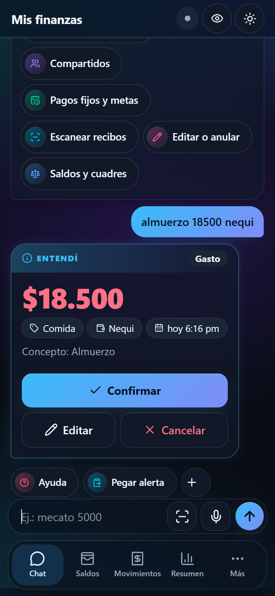<br /><b>Chat</b><br /><sub>La tarjeta "Entendí"</sub></td>
    <td align="center" width="33%"><br /><b>Movimientos</b><br /><sub>Filtros y gasto por categoría</sub></td>
  </tr>
  <tr>
    <td align="center"><br /><b>Deudas</b><br /><sub>Quién te debe y a quién le debes</sub></td>
    <td align="center">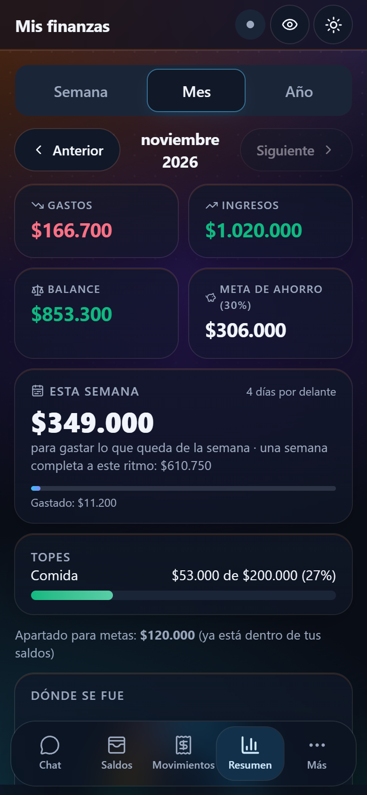<br /><b>Resumen</b><br /><sub>Ritmo, topes y hormiga</sub></td>
    <td align="center">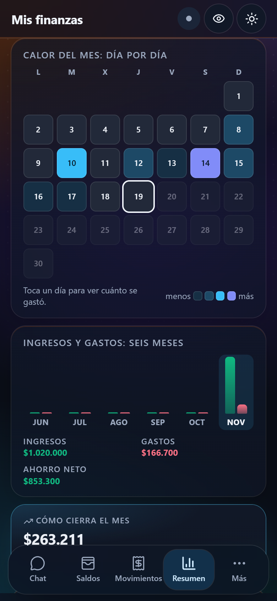<br /><b>Mapa de calor</b><br /><sub>Cada día del mes, por gasto</sub></td>
  </tr>
  <tr>
    <td align="center">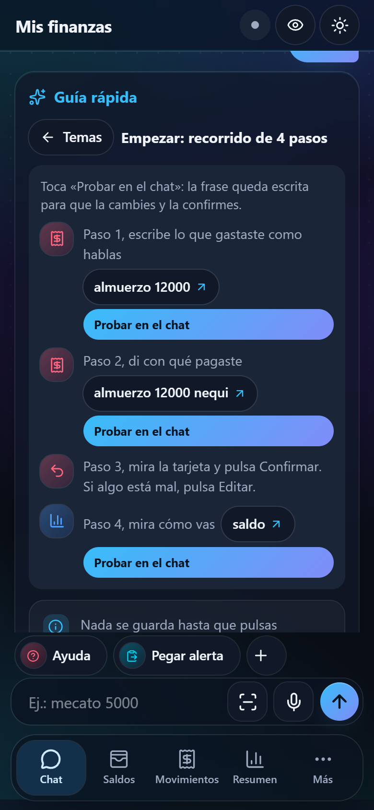<br /><b>Ayuda guiada</b><br /><sub>Temas y recorrido de 4 pasos</sub></td>
    <td align="center">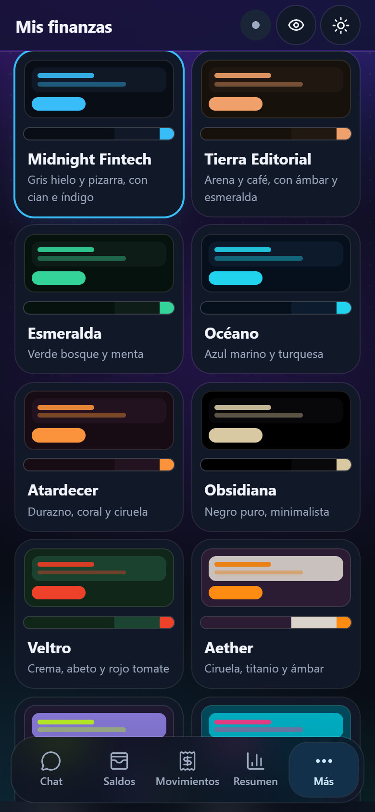<br /><b>Selector de temas</b><br /><sub>Cada tema muestra su 60-30-10</sub></td>
    <td align="center">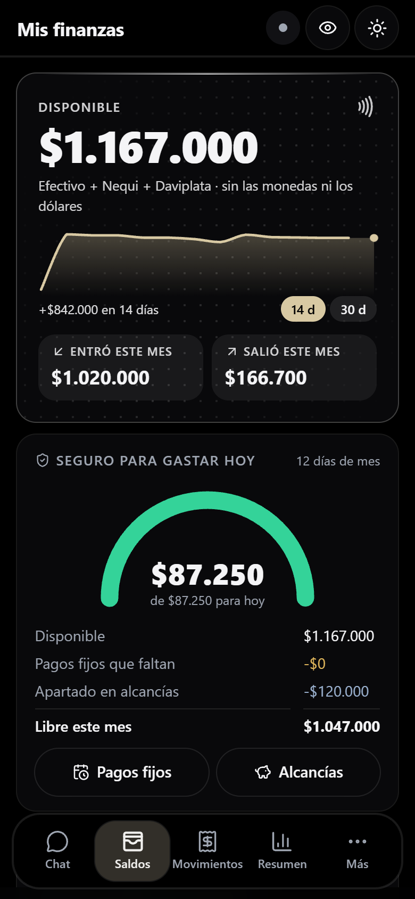<br /><b>Obsidiana</b><br /><sub>Negro puro para AMOLED</sub></td>
  </tr>
  <tr>
    <td align="center">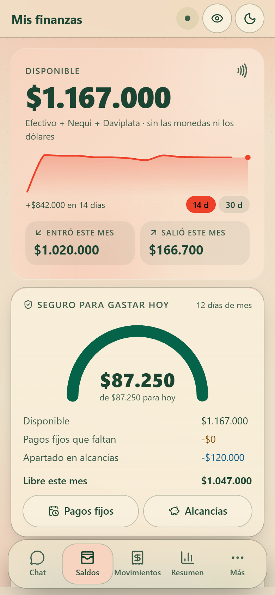<br /><b>Veltro</b><br /><sub>Crema, abeto y tomate</sub></td>
    <td align="center">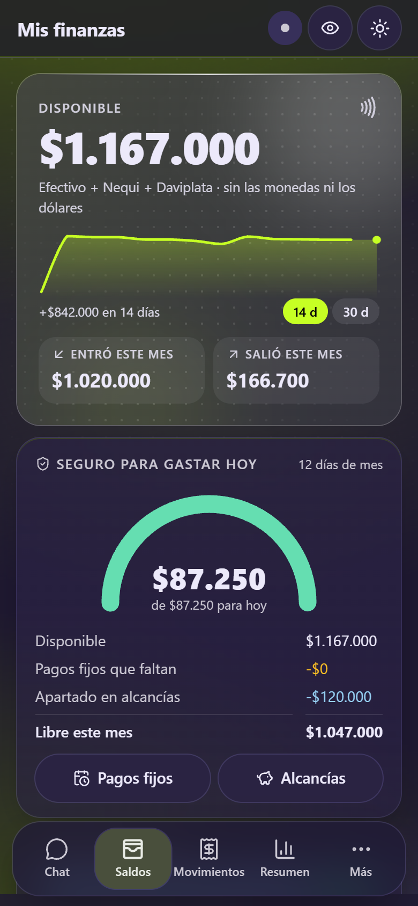<br /><b>Kinetix</b><br /><sub>Índigo, lavanda y voltio</sub></td>
    <td align="center">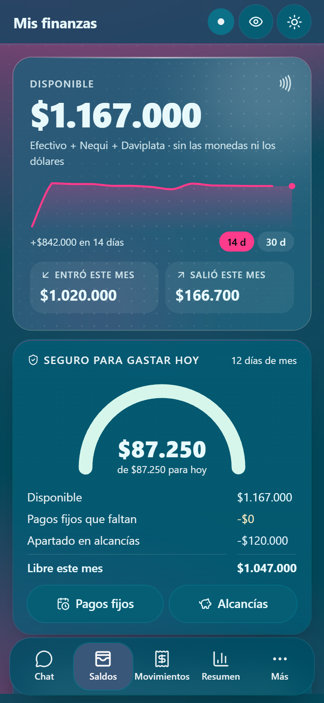<br /><b>Abyss</b><br /><sub>Azul abisal y rosa neón</sub></td>
  </tr>
  <tr>
    <td align="center">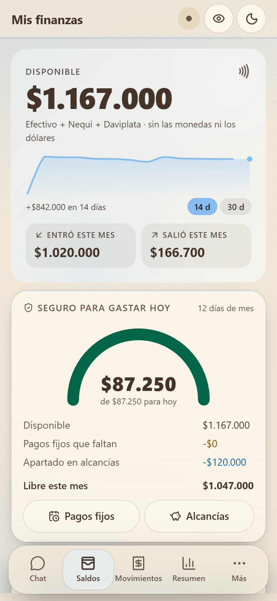<br /><b>Mocha Silk</b><br /><sub>Crema seda y azul cielo</sub></td>
    <td align="center">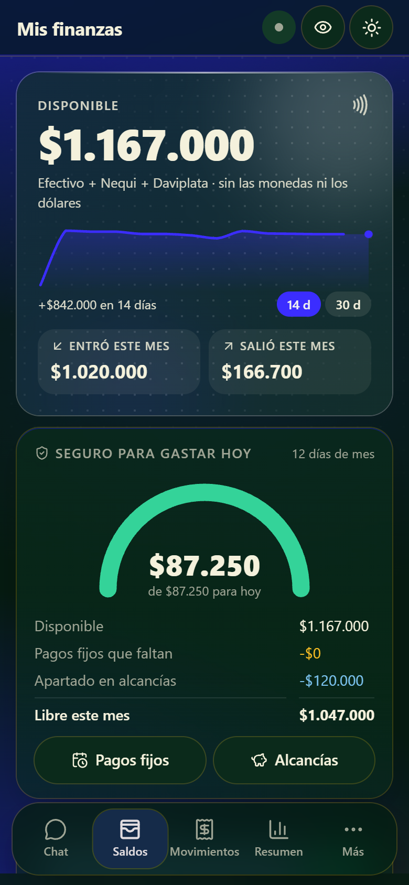<br /><b>Onyx Solar</b><br /><sub>Negro esmeralda, oro e índigo</sub></td>
    <td align="center">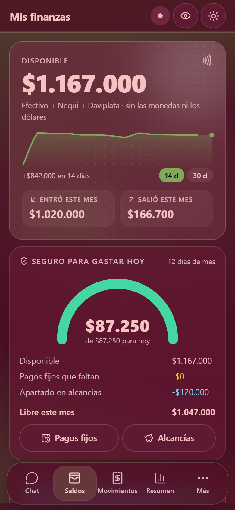<br /><b>Bordeaux Sage</b><br /><sub>Burdeos, rosa polvo y salvia</sub></td>
  </tr>
  <tr>
    <td align="center">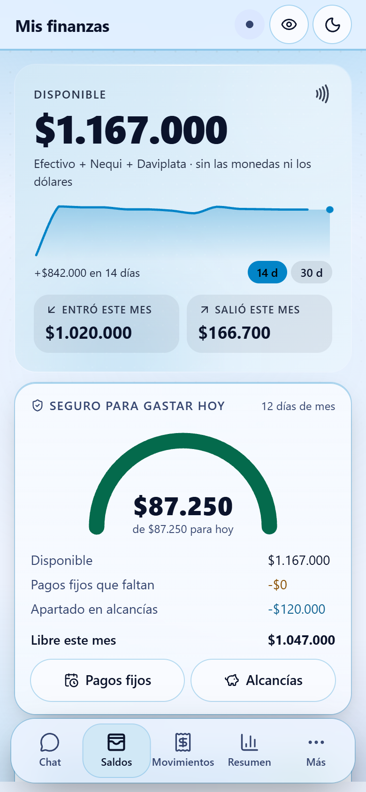<br /><b>Zafiro Real</b><br /><sub>Cobalto, azul real y cian</sub></td>
    <td align="center" valign="middle" colspan="2"><sub>Los nombres y las cifras son inventados.<br />Las imágenes salen de <code>npm run capturas</code>.</sub></td>
  </tr>
</table>

</div>

### Todos los temas

Cada tema tiene su versión oscura y su versión clara, y cada una sale de la misma regla: el 60 % es el fondo, el 30 % las tarjetas y la estructura, y el 10 % el acento (botón principal, pestaña activa, progreso y cifras destacadas).

<div align="center">

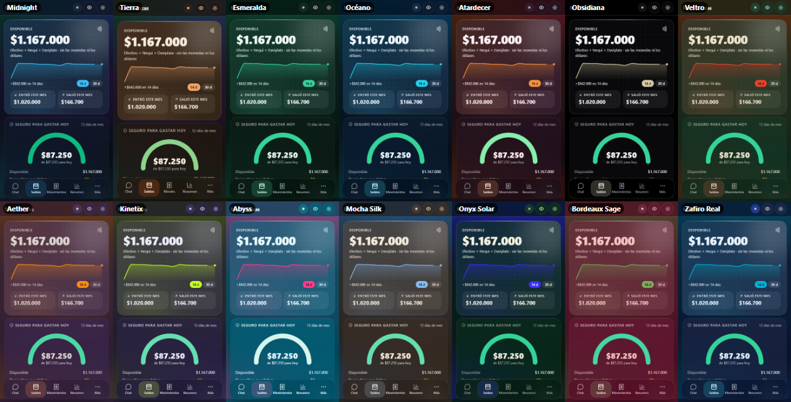

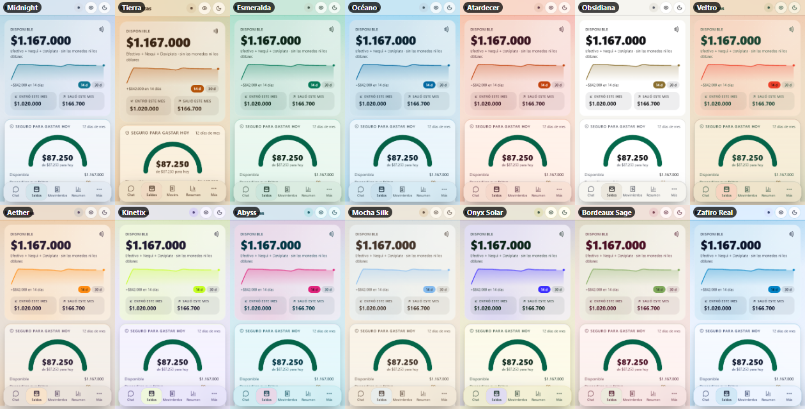

</div>

## Arquitectura

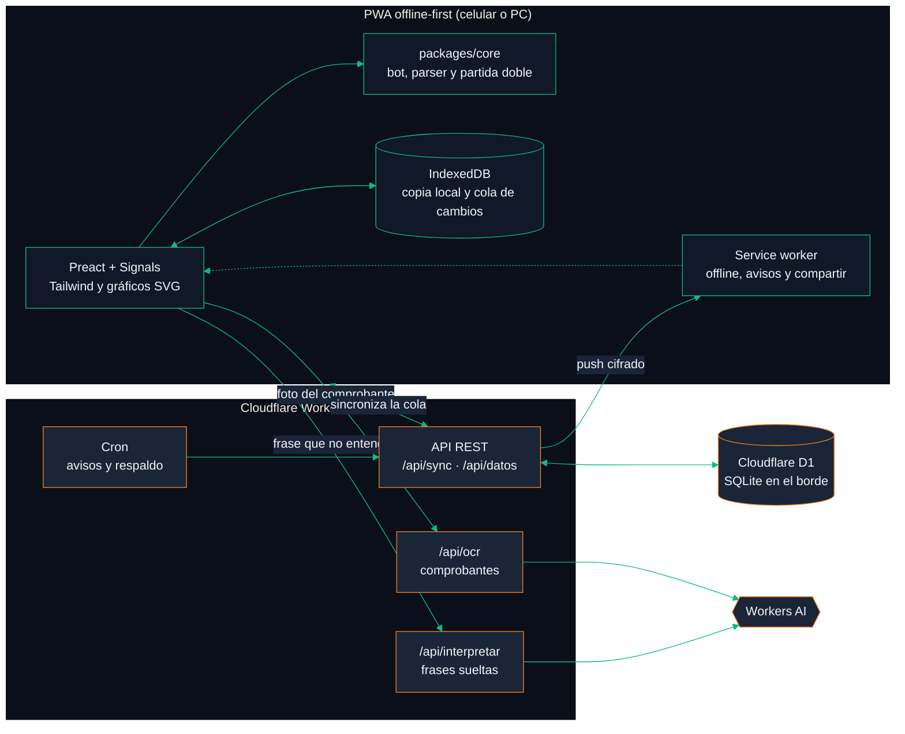

El bot es una librería (`packages/core`), no un servicio: corre dentro del navegador, por eso la app funciona sin internet y hay una sola forma de entender los mensajes. El servidor guarda, sincroniza, avisa y, cuando hace falta, le pide ayuda a la IA. La IA nunca guarda nada: todo pasa por la tarjeta de confirmación.

Más detalle: [docs/ARQUITECTURA.md](docs/ARQUITECTURA.md) y [docs/MOTOR-CONTABLE.md](docs/MOTOR-CONTABLE.md).

## Estructura del monorepo

```text
.
├── apps/
│   ├── web/                    La PWA instalable
│   │   ├── src/
│   │   │   ├── components/     ui/ (íconos, tarjetas, selector) y charts/ (gráficos SVG)
│   │   │   ├── features/       un módulo por pantalla: chat, saldos, movimientos, resumen, metas...
│   │   │   ├── state/          signals: datos, navegación e historial, apariencia
│   │   │   ├── services/       sincronización, IA, lectura de comprobantes, IndexedDB
│   │   │   └── lib/            efectos, imagen, tarjeta para compartir, vibración
│   │   ├── estilos/            Tailwind y los temas (Midnight, claro, Tierra)
│   │   ├── sw.js               service worker: offline, avisos, recibir imágenes compartidas
│   │   └── manifest.webmanifest   accesos directos y share target
│   └── worker/                 El servidor en Cloudflare
│       └── src/rutas/          sync, ia, ocr, push, fotos, buzón, admin
├── packages/
│   └── core/                   El cerebro, sin dependencias de plataforma
│       ├── src/                parser, bot, asientos, consultas, seguro, hormiga, ocr...
│       └── test/               pruebas con node --test
├── db/                         esquema SQL, datos iniciales, diccionario y migraciones
├── scripts/                    instalador, build de la web, ícono, e2e, contraste, privacidad
├── tests/                      ayudas compartidas por las pruebas
└── docs/                       documentación, banners del README y capturas
```

## Despliegue en 3 pasos

> [!IMPORTANT]
> Necesitas Node 24 o superior y una cuenta gratuita de Cloudflare ([cómo crearla](docs/GUIA-CUENTAS.md)). Cada persona o negocio tiene su propia instalación: su Worker, su base D1 y su clave.

**1. Clonar, instalar y probar en local**

```bash
git clone https://github.com/DVLASZ/finanzas.git
cd finanzas
npm install
npm run check        # tipos, pruebas, base de datos, contraste y privacidad
npm run web:dev      # http://localhost:5173, en modo local y sin cuentas
```

**2. Configurar tu instalación y entrar a Cloudflare**

```bash
cp scripts/instalacion-ejemplo.json instalaciones/mi-app.json   # edita plantilla, worker, base y nombre
npx wrangler login
```

**3. Crear la base, llenarla y publicar**

```bash
npm run instalar -- crear mi-app      # crea la D1, aplica el esquema y publica el Worker con la web
npm run instalar -- publicar mi-app   # para publicar de nuevo después de cambiar algo
```

> [!NOTE]
> El instalador genera `instalaciones/mi-app/wrangler.toml` con el identificador de tu base, crea la clave y el PIN y los guarda en `instalaciones/mi-app/acceso.txt` (esa carpeta no se sube a git). Después, abre la dirección que te da en el celular y sigue [docs/INICIO.md](docs/INICIO.md). Para probar la app extremo a extremo antes de publicar: `npm run e2e`.

## Cómo funcionan las ramas

El repositorio tiene tres ramas. Son la misma app con distinta plantilla de cuentas y categorías, y cada una es lo que se publica para ese tipo de instalación:

| Rama | Para quién | Qué cambia |
|---|---|---|
| `main` | Una persona | Efectivo, monedas, Nequi, Daviplata y una cuenta en dólares; categorías de todos los días |
| `familiar` | Una familia | Casa, campo y trabajadores; categorías y personas del hogar |
| `empresa` | Un negocio u organización | Ventas con catálogo, insumos y socios |

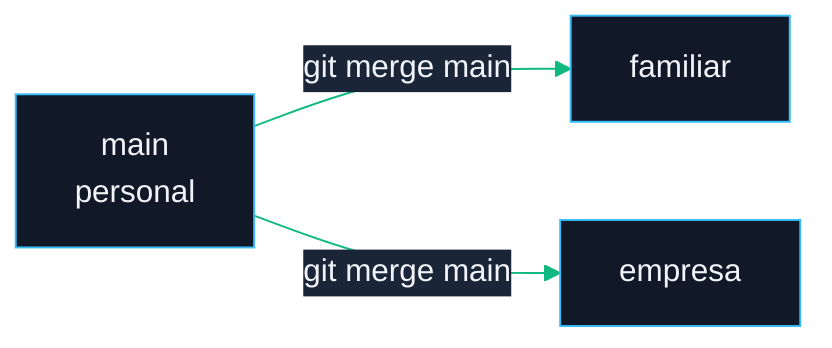

**Si solo quieres usar la app**, clona cualquiera: las tres ramas traen las tres plantillas y en `instalaciones/<nombre>.json` eliges la que quieras con el campo `plantilla`. La rama solo decide cuál viene por defecto (`variante.json`). Cada instalación tiene su propio Worker, su base y su clave, así que nada se mezcla.

**Si quieres cambiar el código**, hazlo en `main`: ahí vive todo lo común (el motor, la interfaz, el servidor). Después se pasa a las otras dos:

```bash
git checkout familiar && git merge main
git checkout empresa && git merge main
```

Tres archivos son propios de cada rama y no se mezclan: `VARIANTE.md`, `variante.json` y `scripts/instalacion-ejemplo.json`. Para que git los respete, una vez por clon: `git config merge.ours.driver true`. El detalle está en [docs/RAMAS.md](docs/RAMAS.md).

## Licencia

MIT. Ver [LICENSE](LICENSE).

## Privacidad

> [!NOTE]
> Este repositorio es solo código. Los datos personales, los respaldos, las claves y las instalaciones de cada persona están en `.gitignore` y no se suben. `npm run privacidad` lo vigila.
