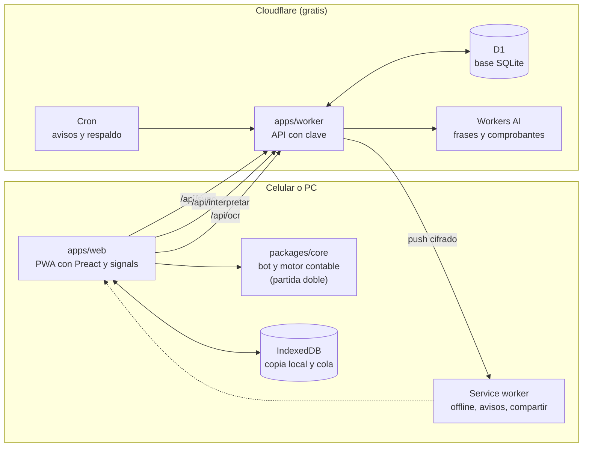

<div align="center">

# Finanzas por mensajes

**Cuéntale tu plata al chat como se la contarías a alguien. La app entiende, tú confirmas, y todo cuadra.**

Una app de finanzas personales y de negocio que funciona sin internet, con partida doble, gráficos interactivos y lectura de comprobantes con IA. Gratis, sobre Cloudflare.


</div>

---

## Qué es

Escribes `mecato 5000`, `presté 40000 a Ana`, `almuerzo 60000 entre Ana, Luis y yo` o `vendí 3 botellas`. El bot muestra lo que entendió, tú pulsas Confirmar y queda guardado. También puedes dictar por voz o fotografiar un comprobante de Nequi o una tirilla de caja.

Cada persona o negocio tiene su propia instalación (su Worker, su base y su clave), así que nada se mezcla. Corre en el plan gratuito de Cloudflare.

## Qué hace

| | |
|---|---|
| **Contabilidad** | Gastos, ingresos, préstamos, deudas, pagos y gastos compartidos con partida doble: todo cuadra siempre. Efectivo con billetes, monedas y vuelto. |
| **Saldos** | Disponible con curva de los últimos días, barra de liquidez contra deudas y el widget "seguro para gastar hoy". |
| **Movimientos** | Filtros, gráfico de dónde se concentra el gasto, detalle con foto del recibo, lectura con IA y tarjeta para compartir por WhatsApp. |
| **Resumen** | Dona interactiva, ritmo de gasto contra el mes anterior, topes y gastos hormiga. |
| **Planear** | Alcancías con fecha estimada de cumplimiento y pagos fijos con aviso antes del cobro. |
| **Comprobantes** | Foto o imagen compartida desde otra app, leída con IA con visión; llega como una tarjeta lista para confirmar. |
| **Sin conexión** | La app guarda todo en el celular y se sincroniza al volver la red. |
| **Móvil nativo** | Se instala desde el navegador, con gesto atrás, accesos directos del ícono y vibración al confirmar. |

## Arquitectura



El bot es una librería (`packages/core`), no un servicio: corre dentro del navegador, por eso la app funciona sin internet y hay una sola forma de entender los mensajes. El servidor guarda, sincroniza, avisa y, cuando hace falta, le pide ayuda a la IA. La IA nunca guarda nada: todo pasa por la tarjeta de confirmación.

Más detalle en [docs/ARQUITECTURA.md](docs/ARQUITECTURA.md) y [docs/MOTOR-CONTABLE.md](docs/MOTOR-CONTABLE.md).

## Stack

| Capa | Tecnología |
|---|---|
| Lenguaje | TypeScript, ejecutado por Node borrando tipos (sin `enum` ni `namespace`) |
| Interfaz | Preact con `@preact/signals` (alias `react` a `preact/compat`) |
| Estilos | Tailwind CSS 4, temas por variables CSS con contraste AA validado |
| Íconos y movimiento | Lucide, `motion/mini`, canvas-confetti, gráficos en SVG propio |
| Empaquetado | esbuild, sin CDN; el service worker guarda todo para uso sin conexión |
| Servidor | Cloudflare Workers, D1 (SQLite) y Workers AI |
| Pruebas | `node --test` para el núcleo y el Worker, Puppeteer para extremo a extremo |

## Tres variantes, tres ramas

| Rama | Variante | Plantilla | Acento del ícono |
|---|---|---|---|
| `main` | App personal | `personal` | Esmeralda y cian |
| `app-2` | App familiar: casa, campo y trabajadores | `familia` | Violeta e índigo |
| `empresa` | Negocio u organización: ventas, insumos, socios | `empresa` | Ámbar y dorado |

Son la misma app con distinta plantilla de cuentas y categorías. El código común se escribe en `main` y se pasa a las otras con `git merge main`. Cada rama tiene su `VARIANTE.md` y su `variante.json`. Cómo se mantienen: [docs/RAMAS.md](docs/RAMAS.md). Las plantillas: [docs/INSTALACIONES.md](docs/INSTALACIONES.md).

## Desarrollo local

Necesitas Node 24 o superior.

```bash
npm install
npm run web:dev      # compila y abre la app en http://localhost:5173, en modo local
npm run check        # tipos, pruebas, base de datos, contraste de colores y privacidad
npm run e2e          # recorre la app en un navegador real
```

## Estructura

```
apps/
  web/src/
    components/    piezas reutilizables: ui/ (íconos, tarjetas, números) y charts/ (gráficos SVG)
    features/      un módulo por pantalla: chat, saldos, movimientos, resumen, metas, recurrentes, mas...
    state/         signals: datos, navegación y apariencia
    services/      sincronización, IA, lectura de comprobantes y almacenamiento local
    lib/           utilidades: efectos, imagen, tarjeta para compartir, vibración
  worker/          el servidor: rutas por dominio, repositorio D1, avisos y respaldo
packages/core/     el cerebro: intérprete, bot, contabilidad, sincronización, IA y Excel
db/                esquema, datos iniciales, diccionario y migraciones
scripts/           instalador, compilación de la web, ícono y herramientas
docs/              documentación (índice en docs/README.md)
```

## Publicar

Una instalación por persona o negocio, con su propio Worker y base:

```bash
npm run check
npm run instalar -- publicar <nombre>
```

La guía completa, desde crear la cuenta de Cloudflare: [docs/INICIO.md](docs/INICIO.md) y [docs/DESPLIEGUE.md](docs/DESPLIEGUE.md).

## Privacidad

Este repositorio es solo código. Los datos personales, los respaldos, las claves y las instalaciones de cada persona están en `.gitignore` y no se suben. `npm run privacidad` lo vigila.
