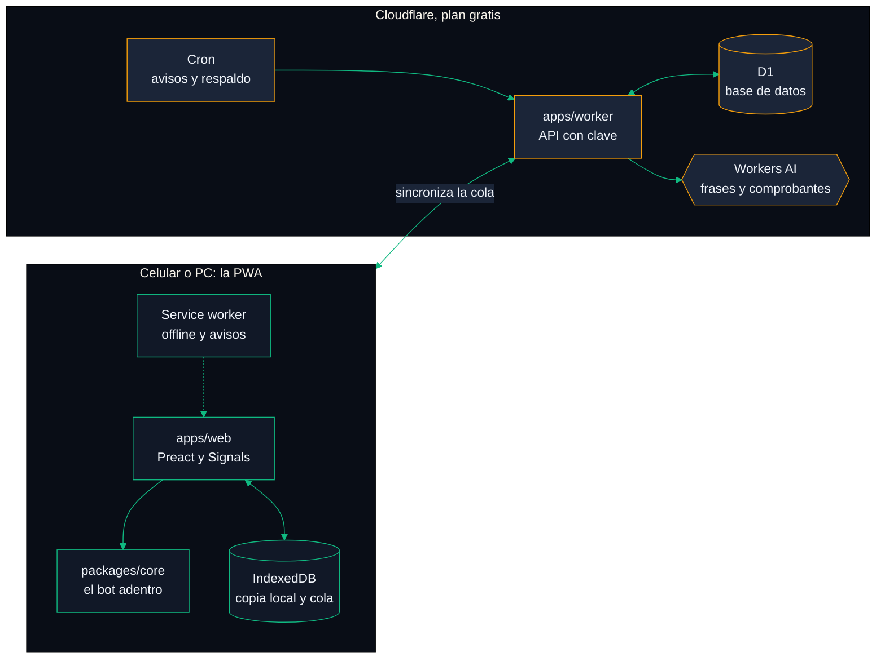
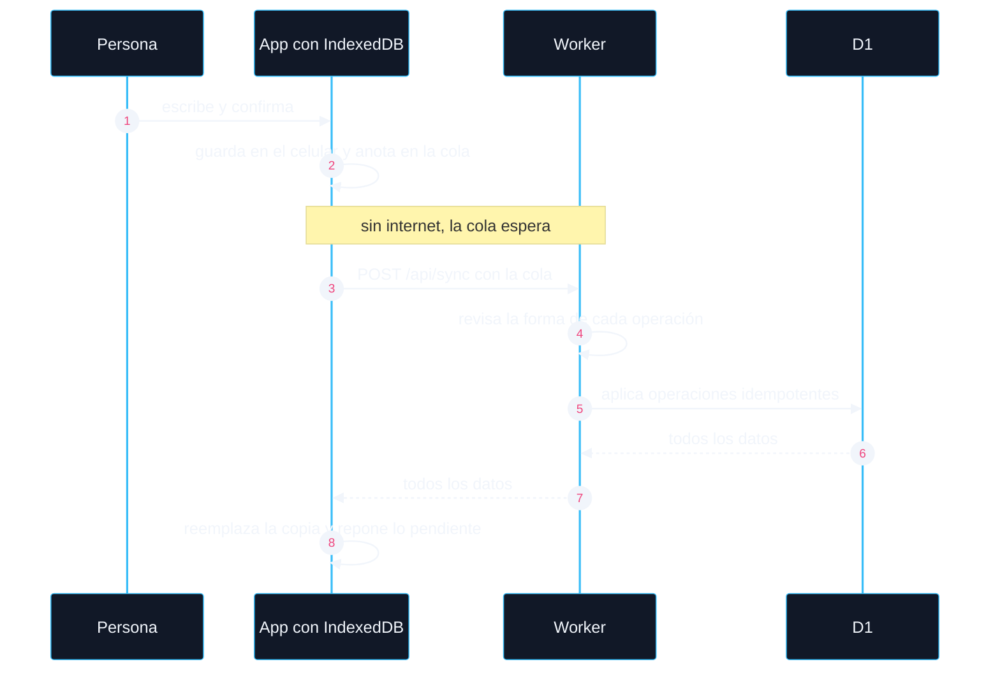

[README](../README.md) · [Empezar](INICIO.md) · [El bot](BOT.md) · [Arquitectura](ARQUITECTURA.md) · [IA](IA.md) · [Desarrollo](DESARROLLO.md) · [Ramas](RAMAS.md) · [Todas las guías](README.md)

# Arquitectura

## Las piezas

La idea de fondo es que el bot es una librería, no un servicio. Vive en `packages/core` y corre dentro del navegador, en el chat de la app. Por eso la app funciona sin internet y no hay dos formas distintas de entender los mensajes.

El servidor casi no tiene lógica de negocio. Guarda, sincroniza, avisa y, si hace falta, pide ayuda a la IA.

Cada instalación (una persona o un negocio) es un Worker, una base D1 y una clave propios, hechos del mismo código. Ver [INSTALACIONES.md](INSTALACIONES.md).

## Carpetas

| Carpeta | Qué tiene |
|---|---|
| `packages/core` | El cerebro. No depende de ninguna plataforma. |
| `apps/web` | La app: componentes de Preact con signals, estilos con Tailwind, copia local en IndexedDB, sincronización, service worker. Ordenada en `components/`, `features/`, `state/`, `services/` y `lib/` (ver [apps/web/README.md](../apps/web/README.md)). |
| `apps/worker` | El servidor: rutas de la API por dominio (`src/rutas/`), repositorio sobre D1, avisos, IA y seguridad (`seguridad.ts`: cabeceras y límites de peticiones). |
| `db` | Esquema, datos iniciales, diccionario de palabras y migraciones. |
| `scripts` | Instalador, compilación de la web y herramientas. |
| `tests` | Ayudas compartidas por las pruebas. |

## El cerebro (`packages/core/src`)

Mapa de archivos del cerebro

| Archivo | Qué hace |
|---|---|
| `tipos.ts` | Los tipos compartidos: cuentas, movimientos, asientos. |
| `texto.ts`, `dinero.ts`, `fechas.ts` | Limpiar texto, encontrar y dar formato a montos, fechas de Colombia. |
| `entidades.ts` | Reconocer cuentas, personas, grupos y categorías, y dar ejemplos con las cuentas de cada app. |
| `parser.ts` | El intérprete: de un mensaje a una propuesta (lo que entendió y lo que falta). Decide qué clase de mensaje es y llama a los módulos de `parser/`. |
| `parser/` | Las reglas por tema: `movimientos` (gasto, ingreso, transferencia), `personas` (préstamos, deudas, regalos, ventas), `pago` (billetes y vuelto), `declaraciones` (saldo inicial y arqueo), `correcciones` (responder y editar una tarjeta), `comun` y `tipos`. |
| `efectivo.ts` | Billetes, monedas y vuelto. |
| `asientos.ts` | De una propuesta a un movimiento con asientos que suman cero. |
| `lineas.ts` | Partir un mensaje con varios movimientos. |
| `ventas.ts` | Catálogo y ventas, con fiado. |
| `consultas.ts` | Saldos, gastos por categoría, deudas y topes. |
| `mensajes.ts` | Los textos: tarjeta, saldos, ayuda. |
| `bot.ts` | La conversación: tarjeta, confirmar, editar, cancelar, deshacer, lista de compras, cola de movimientos. |
| `plantillas.ts` | Las plantillas de instalación. |
| `repo.ts` | La interfaz `Repo` (dónde se guarda) y la versión en memoria. |
| `sync.ts` | Operaciones, validación y cola para sincronizar. |
| `alertas.ts` | Qué conviene avisar: deudas por vencer, topes, días sin anotar. |
| `seguro.ts`, `hormiga.ts`, `metas.ts`, `recurrentes.ts` | El seguro para gastar hoy, los gastos hormiga, las alcancías y los pagos fijos. |
| `pulso.ts`, `presupuesto.ts`, `comparativa.ts` | El gasto de cada día (barras y mapa de calor), los ingresos y gastos de seis meses, lo que se puede gastar esta semana y la comparación con el mes pasado. |
| `liquidez.ts`, `operacion.ts` | La proyección de liquidez a 30 días con los pagos fijos, la cuota semanal de una meta, el stock mínimo y el corte de turno. |
| `notificaciones.ts` | Lee las alertas pegadas de Nequi, Bancolombia y Banco de Bogotá con reglas, sin IA. |
| `recordatorio.ts` | La hora del recordatorio de la noche y cuándo toca avisar. |
| `atajos.ts` | Los botones rápidos del chat: los pagos fijos que tocan y los atajos que arma cada persona. |
| `edicion.ts`, `duplicar.ts` | Editar y duplicar un movimiento guardado, con la vista de lo que cambia (ver [EDITAR.md](EDITAR.md)). |
| `ocr.ts` | Lee la respuesta de la IA con visión y la vuelve una frase para el bot. |
| `ia.ts` | Instrucciones y límites de la ayuda de la IA. |
| `exportar.ts` | El archivo de Excel. |

El bot solo conoce la interfaz `Repo`. Hay tres implementaciones: una en memoria para las pruebas, `D1Repo` en el Worker y `RepoLocal` con `RepoConCola` en la app.

## Rutas del servidor

> [!NOTE]
> Todas piden la clave de la instalación en la cabecera `Authorization: Bearer`.

Tabla de rutas del servidor

| Ruta | Para qué |
|---|---|
| `GET /api/datos` | Todos los datos. |
| `POST /api/sync` | La app manda su cola de cambios y recibe todos los datos. |
| `POST /api/interpretar` | Pide a la IA que reescriba una frase (ver [IA.md](IA.md)). |
| `POST /api/ocr` | Manda la foto de un comprobante a la IA con visión y devuelve monto, fecha, comercio y categoría sugerida. No guarda la imagen. |
| `GET /api/push/clave` | La llave pública para suscribir un celular a los avisos. |
| `POST /api/push/suscribir`, `/baja`, `/probar` | Suscribir, dar de baja y probar los avisos. |
| `POST /api/purgar`, `/api/borrar-todo` | Borrado definitivo. Piden PIN siempre y una frase de confirmación. |

Cualquier otra ruta sirve los archivos de la app. Hay también una tarea (`scheduled`) que corre cada media hora: a las 8 am y a las 6 pm manda los avisos, y en cada media hora mira si toca el recordatorio de la noche. Todas las respuestas, también las de la página, salen con las cabeceras de seguridad de `apps/worker/src/seguridad.ts` (la página las lleva en el archivo `_headers` que escribe la compilación). Las rutas tienen un límite de peticiones por conexión y la IA uno más bajo. El detalle está en [SECURITY.md](../SECURITY.md).

La ruta `/api/sync` revisa la forma de cada operación antes de tocar la base. Una operación mala se rechaza sola y no frena a las demás. Las operaciones son `guardar`, `editar`, `anular`, `restaurar` (deshace una anulación), `compromisos`, `aprendido`, `presupuesto`, `config` y `cuenta`. Desde la app solo se pueden cambiar estas claves de configuración, y cualquier otra se rechaza: `fecha_apertura`, `catalogo`, `lista_compras`, `recurrentes`, `metas`, `categoria_persona`, `apodos_personas`, `grupos`, `subcategorias`, `cerrado_hasta`, `tope_arrastra`, `buzon`, `atajos_usuario` (los botones rápidos de cada persona) y `recordatorio`. La lista vive en `CLAVES_CONFIG_PERMITIDAS` (`packages/core/src/sync.ts`).

## Sin internet y sincronización

1. La app guarda primero en el celular (IndexedDB) y anota cada cambio en una cola.
2. Cuando hay internet (al abrir, al recuperar la red, al volver a la app, cada minuto) manda la cola a `/api/sync`.
3. El servidor aplica las operaciones, que son idempotentes: repetirlas no duplica. Responde con todos los datos.
4. La app reemplaza su copia y vuelve a poner encima lo que hiciste mientras tanto.

Como cada instalación la usa una sola persona, los choques casi no existen. Sin servidor configurado, la app es un cuaderno local completo, con las cuentas de su plantilla.

## Seguridad

| Qué | Cómo se protege |
|---|---|
| La API | Clave larga, comparada en tiempo constante. |
| Borrados definitivos | PIN en el servidor y una frase. En la app hay también PIN local, espera de 5 segundos y una última confirmación. |
| Secretos | `wrangler secret put`. Nunca en git. |
| Avisos | Llaves del servidor guardadas en claves `secreto_` de la base, que no salen del servidor. El aviso va cifrado. |
| Datos | El bot anula, no borra. Una partida que no suma cero no se guarda. |

## Decisiones y por qué

- Partida doble: un mismo modelo resuelve gastos, ingresos, préstamos, ventas y todo lo demás sin casos especiales, y un movimiento que no cuadra se nota al instante. Ver [MODELO-DATOS.md](MODELO-DATOS.md).
- Cloudflare y no otra cosa: una sola cuenta, plan gratuito, y D1 no se pausa por falta de uso.
- La IA solo reescribe: nunca guarda. Todo pasa por la tarjeta de confirmación.
- PWA y no app nativa: se instala desde el navegador, sin tiendas ni costos.
- Una instalación por persona o negocio: nada se mezcla y cada quien tiene su aspecto.
- Los dólares no se convierten a pesos solos. El dólar cambia y una tasa vieja daría un saldo engañoso.
- `cargar()` trae todo: con el volumen de una persona es lo más simple y rinde bien.
