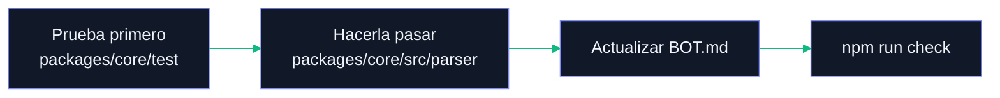

[README](../README.md) · [Empezar](INICIO.md) · [El bot](BOT.md) · [Arquitectura](ARQUITECTURA.md) · [IA](IA.md) · [Desarrollo](DESARROLLO.md) · [Ramas](RAMAS.md) · [Todas las guías](README.md)

# Guía de desarrollo

## Lo que necesitas

> [!IMPORTANT]
> Node 24 o superior. Ejecuta TypeScript directo, sin compilar.

| Comando | Qué hace |
|---|---|
| `npm run check` | Tipos, pruebas, base de datos, contraste de colores, privacidad del repositorio y seguridad. Tiene que pasar antes de cada commit |
| `npm run typecheck` | Solo los tipos |
| `npm test` | Las pruebas del núcleo y del Worker |
| `npm run verificar` | Arma la base en memoria y revisa que todo cuadre |
| `npm run contraste` | Revisa que los colores se lean bien (AA) en todos los temas, también el texto sobre el vidrio con la aurora y el mapa de calor |
| `npm run paletas` | Reescribe los colores de todos los temas desde `scripts/paletas.mjs` (ver «Temas» abajo) |
| `npm run seguridad` | `npm audit`, secretos dentro de git, consultas a D1 con parámetros, funciones peligrosas en la interfaz y cabeceras del Worker (ver [SECURITY.md](../SECURITY.md)) |
| `npm run privacidad` | Que lo que sigue git no lleve datos personales |
| `npm run capturas` | Vuelve a sacar las capturas de `docs/screenshots/` con datos inventados |
| `npm run web:build` | Compila la app a `apps/web/dist` |
| `npm run web:dev` | Compila y sirve la app en `http://localhost:5173` |
| `npm run instalar -- <orden> <nombre>` | Crea o publica una instalación (ver [DESPLIEGUE.md](DESPLIEGUE.md)) |
| `npm run guia -- <plantilla>` | Arma la guía de usuario de una app con sus cuentas y categorías (queda en `docs-privado/`) |
| `npm run abrir-respaldo -- <archivo>` | Abre un respaldo cifrado de la nube (ver [RESPALDO.md](RESPALDO.md)) |
| `npm run e2e` | Abre la app en tu Chrome y recorre las pantallas como una persona (44 pruebas en tamaño de celular; en el celular real son 18, porque subir una imagen desde un archivo solo corre en PC). No va en `check` porque necesita Chrome |
| `npm run e2e:letra` | Revisa que nada se desborde con letra grande en un celular angosto (393 px, como el Redmi Note 14), con varias escalas de texto. `ESCALAS=1,1.3` y `INSTALACION=personal` ajustan la prueba |
| `npm run e2e:variantes` | Corre esa misma revisión en las tres variantes (personal, mamá y asociación), con texto normal y al 130 %: chat, saldos, movimientos, resumen, edición, duplicar y todo el menú Más |
| `npm run salud` | Pregunta a cada instalación publicada cómo va: movimientos, último movimiento, avisos, IA |

## Convenciones

- Todo en español: el código de dominio, los comentarios y la documentación.
- Los comentarios explican el porqué, con un ejemplo cuando ayuda.
- Node borra los tipos sin compilar, así que no se usan `enum`, `namespace` ni parámetros-propiedad en constructores, y los imports llevan la extensión `.ts`. `tsconfig.json` lo vigila con `erasableSyntaxOnly`.
- `packages/core` no importa nada de Cloudflare ni del navegador. Cada plataforma se conecta por la interfaz `Repo`.
- El dinero va en enteros y las fechas son la hora de Colombia como texto.
- Las pantallas de cifras importan `formatear` de `lib/formatear.ts`, no del núcleo: así el modo privacidad (el ojo de la cabecera) esconde los montos. Un texto con montos adentro pasa por `verTexto`. Los flujos que la persona abre a propósito (cuadre, edición, informes) usan el del núcleo.
- Antes de subir, `npm run check` ahora incluye `npm run seguridad`. Si agregas una consulta a D1, va con `?` y `.bind()`, nunca con `${}`. Si agregas un script a la página, va en un archivo y no en línea: la política de contenido del Worker lo prohíbe, y `servir-web.mjs` ya sirve con esas mismas cabeceras para que `e2e` lo note.
- Nada de `alert`, `confirm` ni `prompt`: salen con el cuadro del navegador y rompen el diseño. Se usan `confirmar`, `avisar` y `pedir` de `components/ui/Dialogo.tsx`, que siguen el tema y la letra grande. Una prueba lo vigila.
- Los commits van a nombre de quien los hace, en español, cortos y en minúscula.
- Nada de datos personales ni secretos en git. Mira `.gitignore`.
- Los textos de la documentación se escriben como habla una persona: sin emojis, sin flechas, sin frases de folleto.

## Pruebas

Las pruebas viven junto a lo que prueban. Se corren con `node --test`, sin librerías.

Mapa de las pruebas

| Dónde | Qué cubre |
|---|---|
| `packages/core/test/basicos` | Montos, fechas, periodos y formatos |
| `packages/core/test/bot` | El bot de punta a punta: gastos, vuelto, transporte, ingresos, personas, deudas, compartidos, saldos, topes |
| `packages/core/test/efectivo` | Billetes, monedas y vuelto |
| `packages/core/test/personas` | Grupos, roles, regalos y apodos |
| `packages/core/test/docs` | Que cada ejemplo de `docs/BOT.md` se entienda |
| `packages/core/test/plantillas` | Cada app con sus cuentas, alcancía, otras cuentas |
| `packages/core/test/ventas` | Catálogo, fiado y lista de compras |
| `packages/core/test/lineas` | Varios movimientos en un mensaje |
| `packages/core/test/ia` | Instrucciones, limpieza de respuestas y tope diario |
| `packages/core/test/exportar` | El Excel, abierto con ExcelJS |
| `packages/core/test/alertas` | Deudas por vencer, topes y días sin anotar |
| `packages/core/test/nuevas` | Seguro para gastar, gastos hormiga, alcancías, lectura de comprobantes, revisión del mes, reparto «entre ... y yo», fechas en hora Colombia, cola de sincronización y subcategorías de tres niveles |
| `packages/core/test/robustez`, `estres` | Entradas raras y mensajes al azar con semilla fija |
| `packages/core/test/datos` | La semilla coincide con `seed.sql` y el diccionario |
| `apps/worker/test/worker` | La API: sincronización, rechazos, borrados con PIN, ayuda de la IA |
| `apps/worker/test/push` | Avisos: cifrado, firma, rutas y tarea diaria |
| `apps/worker/test/estres-d1` | Estrés contra una D1 simulada |

El Worker se prueba contra una D1 simulada sobre SQLite (`tests/d1-shim.ts`), sin red ni cuentas. La IA se prueba con una falsa. Lo que ninguna prueba cubre es cómo se ve y se siente en un celular real. Eso se prueba a mano.

## Cómo agregar cosas

> [!TIP]
> `docs/BOT.md` también es una prueba: cada ejemplo de sus bloques de código se corre contra el bot. Si el bot deja de entender uno, `npm run check` falla.

Que el bot entienda algo nuevo:
1. Escribe primero la prueba en `packages/core/test/bot.test.ts` (o en el archivo del tema): qué escribe la persona y qué debe responder o guardar.
2. Hazla pasar en el módulo de `packages/core/src/parser/` que corresponda al tema (`parser.ts` solo decide a cuál llamar). Si es un tipo de movimiento nuevo, también `asientos.ts`, `mensajes.ts` y la tabla de [MODELO-DATOS.md](MODELO-DATOS.md).
3. Actualiza [BOT.md](BOT.md).

Una categoría nueva: `db/seed.sql`, `packages/core/src/semilla.ts` y las palabras en `db/diccionario.json`. Si ya está en producción, una migración o un INSERT en cada base.

Una cuenta o grupo nuevo para una plantilla: `packages/core/src/plantillas.ts`. Las bases ya publicadas no se enteran solas, hay que insertarlo con SQL.

Una pantalla nueva: una carpeta en `apps/web/src/features/` con su componente, que lee sus datos de `apps/web/src/state/store.ts`; su nombre en `Pantalla` (`state/nav.ts`) y, si se abre desde Más, su entrada y su caso en `features/mas/Mas.tsx`. Las piezas que se repiten van en `apps/web/src/components/ui/` y los gráficos en `components/charts/`.

Un cambio de esquema: [MODELO-DATOS.md](MODELO-DATOS.md#cambiar-el-esquema).

## Probar la app en el navegador

`npm run web:dev` y abre `http://localhost:5173`. Sin servidor, la app trabaja en modo local con las cuentas de su plantilla.

El service worker, que es lo que da el modo sin internet, solo se registra en HTTPS o en localhost. Cuando pruebes un cambio y no lo veas, es casi seguro que el navegador guardó la versión vieja: borra los datos del sitio o desregistra el service worker.

## Tropiezos que ya pasaron

Tropiezos frecuentes

- Un cambio en una plantilla no llega solo a las bases ya publicadas. Se aplica con `npm run instalar -- actualizar <nombre>` (ver [INSTALACIONES.md](INSTALACIONES.md)).
- Un cambio de esquema es una migración nueva y numerada. `npm run verificar` comprueba que las migraciones dejen el mismo esquema que `db/schema.sql`.
- Si el navegador sigue mostrando una versión vieja de la app, es el service worker. Se desregistra desde las herramientas del navegador, o se cierra y abre la app con internet.
- Los datos de una instalación (personas, apodos, categoría fija de una persona) van por SQL o por `instalaciones/<nombre>.json`, nunca en la plantilla: la plantilla es del código y no lleva nombres de nadie.
- Al escribir expresiones regulares por línea de comandos se pueden perder las barras invertidas. Si una regla del parser no responde, mira que la expresión haya quedado bien en el archivo.

## Temas

Los temas siguen la regla de diseño 60-30-10: el 60 % es el fondo y el ambiente de la pantalla, el 30 % son las tarjetas, la estructura y el texto principal, y el 10 % es el acento, que se reserva para lo clave (el botón principal de confirmar o enviar, la pestaña activa, los indicadores de progreso y las cifras destacadas). Cada tema (una «piel») existe en oscuro y en claro, y cada versión tiene su propio ambiente: el modo claro de Tierra es arena con terracota, el de Fintech es gris hielo con pizarra, y así con todos.

Los colores se definen en un solo lugar, `scripts/paletas.mjs`, con tres colores de intención por tema (`f` el 60 %, `s` y `e` el 30 %, `a` y `a2` el 10 %) más el texto. De ahí `npm run paletas` deriva todo lo demás y lo escribe en tres archivos que no se editan a mano:

- el bloque entre `PALETAS:INICIO` y `PALETAS:FIN` de `apps/web/estilos/temas.css` (los oscuros de Midnight y de Tierra, y los matices, siguen a mano en ese archivo);
- `apps/web/estilos/auroras.css`, con los brillos de la aurora de cada tema;
- `apps/web/src/features/ajustes/temas.generated.ts`, la lista del selector con los colores de la píldora 60-30-10.

La derivación ajusta sola lo que haga falta para llegar a AA (4,5 a 1) sobre todos los fondos donde se usa: el texto suave, el texto sobre el acento, los colores de ingreso, gasto, alerta y dato, y el acento cuando se usa como texto. Por eso un acento muy vibrante, como el rojo tomate de Veltro, es el relleno del botón y a la vez tiene una versión más oscura (`--marca-tx`) para los textos y los íconos. Los brillos de la aurora se oscurecen conservando su tono hasta que el texto se lea en el peor caso. `npm run contraste` no se fía del generador: vuelve a medir desde el CSS, y por eso también revisa el texto sobre la tarjeta grande de Saldos y sobre el mapa de calor.

Para agregar un tema: una entrada nueva en `PALETAS` (en oscuro y en claro) y su nombre en `NOMBRES`, `npm run paletas`, y sumar su nombre a la unión `Piel` de `apps/web/src/state/apariencia.ts`. Si el tema usa medidas distintas (radios, alto de botones), se agrega su regla en `temas.css`. Obsidiana es el caso especial: sin aurora ni vidrio, con las reglas propias que están al final de `tailwind.css`.
