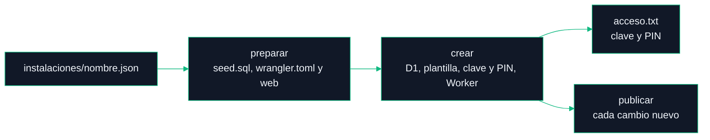

[README](../README.md) · [Empezar](INICIO.md) · [El bot](BOT.md) · [Arquitectura](ARQUITECTURA.md) · [IA](IA.md) · [Desarrollo](DESARROLLO.md) · [Ramas](RAMAS.md) · [Todas las guías](README.md)

# Despliegue

Hay dos caminos. Lo normal es el instalador, que maneja una app por persona o negocio. El camino a mano sirve para entender qué hace el instalador por debajo.

> [!WARNING]
> Las claves las escribes tú en tu terminal. No las pegues en chats ni las subas a git.

## Con el instalador



```bash
npx wrangler login
npm run instalar -- preparar <nombre>
npm run instalar -- crear <nombre>
npm run instalar -- publicar <nombre>
```

- `preparar` genera `seed.sql`, `wrangler.toml` y la web de esa instalación en `instalaciones/<nombre>/`, sin tocar la nube.
- `crear` crea la base en Cloudflare, la llena con la plantilla, guarda la clave y el PIN en `instalaciones/<nombre>/acceso.txt` y publica. Pide confirmación en cada paso.
- `publicar` vuelve a compilar y publicar después de un cambio. No toca los datos.

Todo sale de `instalaciones/<nombre>.json` (hay un ejemplo en `scripts/instalacion-ejemplo.json`). Para una base que ya existe, pon su `d1Id` en el JSON y usa `publicar`.

El `wrangler.toml` que genera el instalador trae lo que necesita cada app: la base, los archivos de la web, la ayuda de la IA y la tarea diaria de avisos.

## A mano, una sola app

<details>
<summary>Ver los pasos a mano</summary>

```bash
npm install
npm run check
npx wrangler login
npx wrangler d1 create finanzas
```

Copia el `database_id` que imprime en `apps/worker/wrangler.toml`. Después:

```bash
npx wrangler d1 migrations apply finanzas --remote --config apps/worker/wrangler.toml
npx wrangler secret put API_TOKEN --config apps/worker/wrangler.toml
npx wrangler secret put PIN_BORRADO --config apps/worker/wrangler.toml
npm run web:build
npx wrangler deploy --config apps/worker/wrangler.toml
```

Para una clave larga y al azar: `node -e "console.log(require('crypto').randomBytes(24).toString('hex'))"`.

Para ver qué secretos existen, solo los nombres: `npx wrangler secret list --config apps/worker/wrangler.toml`.

</details>

## Cambios de esquema

Una migración nueva y numerada en `db/migrations/`, aplicada a cada base con `npx wrangler d1 migrations apply <base> --remote`. Actualiza también `db/schema.sql`, `db/seed.sql` y `packages/core/src/semilla.ts`.

## Revisar que quedó bien

- La dirección `https://<worker>.<subdominio>.workers.dev/` abre la app.
- `/api/datos` sin clave responde 401. Con `Authorization: Bearer <clave>` responde los datos.
- Los registros en vivo: `npx wrangler tail --config <el wrangler.toml>`.

## Si cambiaste las cuentas de una plantilla

<details>
<summary>Aplicar el cambio con SQL a cada base</summary>

Las bases ya publicadas no se actualizan solas con la plantilla. Hay que aplicar el cambio con SQL a cada una:

```bash
npx wrangler d1 execute <base> --remote --config instalaciones/<nombre>/wrangler.toml --command "INSERT OR IGNORE INTO cuentas (id, nombre, clave, tipo, moneda, grupo, fijo, en_disponible) VALUES ('alcancia','Alcancía','alcancia','dinero','COP',NULL,0,0);"
```

</details>

