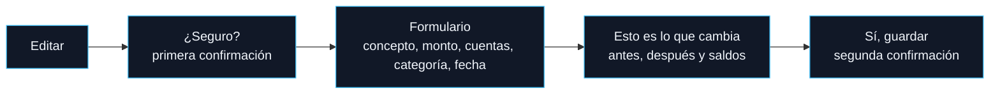

[README](../README.md) · [Empezar](INICIO.md) · [El bot](BOT.md) · [Arquitectura](ARQUITECTURA.md) · [IA](IA.md) · [Desarrollo](DESARROLLO.md) · [Ramas](RAMAS.md) · [Todas las guías](README.md)

# Editar un movimiento

Si te equivocaste en algo que ya guardaste, no hace falta anularlo y escribirlo otra vez. En Movimientos, toca el movimiento y pulsa Editar.

## Duplicar

Junto a Editar y Anular está **Duplicar**: crea un movimiento nuevo, igual a este pero con la fecha de hoy, para repetir un gasto o una compra sin escribirla otra vez. Antes de guardar muestra cómo quedaría y avisa si una cuenta no alcanza. El original no cambia. Solo se duplican los gastos, ingresos y transferencias; un préstamo, una deuda o un gasto compartido arrastran a otras personas y ahí es mejor escribirlo en el chat.

## Historial

El detalle de cada movimiento dice cuándo se anotó y, si se editó, cuándo fue la última vez.

## Qué se puede cambiar

| Tipo de movimiento | Qué deja cambiar |
|---|---|
| Gasto, ingreso, transferencia | Monto, cuentas, categoría o fuente, concepto y fecha |
| Venta del catálogo | Cantidad (el monto sale de la cantidad por el precio), cuenta, concepto y fecha |
| Préstamo, deuda, pago, gasto compartido, venta fiada | Solo concepto y fecha. El monto está atado a lo que debe cada persona: para cambiarlo, anula y vuelve a anotar |
| Saldo inicial, arqueo, cambio de moneda, anulados | Nada. La pantalla explica qué hacer en su lugar |

Un movimiento que vino de un archivo y no guarda cómo se armó solo deja cambiar concepto y fecha.

## Lo que revisa antes de guardar

- Los asientos se rehacen juntos, así la partida doble sigue sumando cero. El movimiento conserva su id: no queda un duplicado anulado.
- Si una cuenta se queda sin plata con el cambio, lo dice. Si cambia el sentido de una deuda, también.
- Si hay un arqueo posterior sobre una cuenta que se toca, avisa que el cambio mueve el saldo que ya habías cuadrado.
- Si cambias la cantidad de una venta, las existencias se ajustan solas y avisa si no alcanzan.
- Un mes cerrado no se edita, ni se puede sacar un movimiento de él. Una fecha del futuro tampoco.
- Una fecha anterior al saldo inicial hace que el movimiento deje de contar en los saldos, y lo avisa.

> [!NOTE]
> En el detalle del movimiento queda escrito «Editado» con la fecha. En la base se guarda en `editado_en` y se sincroniza como cualquier cambio, también desde el celular sin conexión.

Cómo está hecho

- `packages/core/src/edicion.ts` tiene `capacidadesDeEdicion`, `previsualizarEdicion` y `aplicarEdicion`. Son funciones puras: la pantalla las llama en cada cambio del formulario.
- Al confirmar, el repositorio recibe `editarMovimiento`, que reemplaza el movimiento y sus asientos de una sola vez. En el servidor es un lote de D1: o cambia todo o no cambia nada. La operación de sincronización se llama `editar`.
- Si el servidor rechaza una edición (por ejemplo, porque el movimiento se anuló en otro aparato), la app vuelve a traer todo en la próxima sincronización.
- La pantalla está en `apps/web/src/features/movimientos/EditarMovimiento.tsx` y se prueba con `npm run e2e` y `npm run e2e:letra`.

## Deshacer

Al guardar la edición sale abajo, ocho segundos, una barra con «Deshacer»: devuelve el movimiento a como estaba antes, con una sola operación (la edición es un reemplazo completo, así que deshacerla también lo es). Lo mismo pasa al guardar un movimiento nuevo, al duplicar y al anular. Para deshacer una anulación existe la operación `restaurar`: el movimiento vuelve a contar y sus deudas a estar activas.
