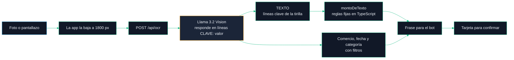

[README](../README.md) · [Empezar](INICIO.md) · [El bot](BOT.md) · [Arquitectura](ARQUITECTURA.md) · [IA](IA.md) · [Desarrollo](DESARROLLO.md) · [Ramas](RAMAS.md) · [Todas las guías](README.md)

# Ayuda de la IA

Las reglas del bot entienden casi todo lo de todos los días, pero una frase muy suelta como "me llegaron cincuenta mil de mi tía y gasté 5 lukas en mecato" se les escapa. Para esos casos el servidor puede pedirle ayuda a una IA.

## La guía de ayuda no usa la IA

«Pregúntale cómo decirlo» busca en temas escritos (palabras y frases clave) y no llama al modelo: así funciona sin internet, no gasta la cuota diaria y siempre da un ejemplo con tus cuentas. Si no encuentra tema, lo dice y deja tocar uno de la lista. Cuando una frase no la entiende el bot al escribirla en el chat, ahí sí entra la IA. Si algún día se quiere que la guía le pregunte al modelo, hace falta una ruta nueva en el Worker con su propio tope diario; hoy no se justifica.

## Qué hace y qué no

> [!NOTE]
> La IA no guarda nada. Solo reescribe lo que escribiste en frases cortas que el bot de siempre sí entiende, por ejemplo `ingreso 50000 tía` y `mecato 5000`. Esas frases pasan por el bot y por la tarjeta de confirmación como cualquier mensaje. Si la IA se equivoca, lo ves antes de confirmar.

La app lo hace sola cuando el bot responde que no entendió, hay servidor configurado y hay internet. Verás un "Déjame pensarlo un momento" y luego "Creo que quisiste decir". Si la IA tampoco entiende, queda el mensaje normal del bot.

Las reglas del bot corren primero y sin red, y entienden los modismos de uso diario (ver «Como lo dice la gente» en BOT.md). La IA entra solo con lo que las reglas no pudieron leer. Sus instrucciones llevan las formas canónicas de los gastos repartidos, la jerga de deudas y los verbos de mover plata, y le piden que responda `{"frases": []}` en vez de inventar cuando no sabe entre cuántos se repartió algo o qué cuenta es. Lo que devuelve vuelve a pasar por el bot y por la tarjeta de confirmación.

Lo que devuelve la IA se revisa dos veces, en el servidor y otra vez en la app (`validarFrasesIA`, en `core/src/ia.ts`), frase por frase:

- Solo pasan movimientos. Un comando que la IA se invente (`deshacer 3`, `cerrar mes septiembre`, `quitar meta moto`) se descarta: nunca se ejecuta sin tarjeta.
- Cada monto tiene que salir de lo que escribiste (o de una suma, una resta o una parte igual de tus montos). Una persona que no nombraste, una cuenta o categoría que no existe, o un ingreso donde hablaste de un gasto, también se descartan.
- Si una frase no se entiende se descarta solo esa; las demás siguen.
- Se limpia la salida: sin HTML ni saltos ni caracteres de control, hasta 5 frases de 160 letras como máximo.

Si la IA tarda más de 20 s (15 s desde la app) o falla, no se cuenta esa ayuda del día. El error 502 trae un motivo corto (`tardó demasiado`, `el modelo falló`, `respuesta sin formato`), nunca el texto interno del modelo.

Sin internet no hay ayuda de la IA: el bot dice lo que no entendió y reescribes la frase más simple.

## Leer comprobantes



La misma IA, con un modelo que ve imágenes, lee comprobantes: un pantallazo de Nequi, Daviplata o Bancolombia, o la foto de una tirilla de caja. Desde el botón de la cámara del chat, desde el detalle de un movimiento con foto, o compartiendo la imagen hacia la app desde otra app (el ícono ofrece «compartir» cuando la app está instalada).

La app baja la foto a unos 150 KB y la manda a `POST /api/ocr`. El servidor devuelve monto, fecha, comercio y una categoría sugerida, y la app los vuelve una frase («mercado tienda don pepe 45000») que pasa por el bot y por la tarjeta de confirmación. Nada se guarda sin que pulses Confirmar, y la imagen no queda en ningún registro del servidor.

El modelo es `@cf/meta/llama-3.2-11b-vision-instruct`, que sigue vigente. Antes se usó LLaVA 1.5 (7B), que con una tirilla real de D1 inventó el monto, tomó «Cambio» por el comercio y la fecha de la resolución de la DIAN por la de la compra. Las instrucciones (`INSTRUCCIONES_OCR` en `packages/core/src/ocr.ts`) le piden el TOTAL general que está debajo de la lista de artículos, ignorar la tabla «RESUMEN DE IMPUESTOS» (su BASE se confundió con el total), CAMBIO y VUELTO, tomar la fecha de arriba y el nombre del encabezado. La lectura también descarta una fecha de hace más de un año o del futuro, y las palabras de factura como comercio. Como el modelo igual elegía mal entre el total y la tabla de impuestos, también transcribe las líneas clave (`TEXTO`) y el monto se busca en TypeScript con reglas fijas (`montoDeTexto`): se corta el texto desde «RESUMEN DE IMPUESTOS», «EXCLUIDO» o «EXENTO», y se toma el valor de las líneas VALOR PAGADO, TOTAL o tarjeta, por ese orden. Eso manda sobre el monto que el modelo eligió. El nombre del comercio se recorta en el NIT. La respuesta se pide en líneas `CLAVE: valor` y no en JSON, porque un `TEXTO` de varias líneas dentro de un JSON trae saltos de línea sueltos que lo rompían (la app decía «No pude leer el monto»). Si el modelo contesta JSON igual, el lector repara esos saltos. Probado con una tirilla de prueba parecida a la de D1 (datos inventados) contra el modelo real: lee el total, la fecha, el comercio y la categoría bien, dos de dos veces. Aun así, la tarjeta siempre se revisa antes de confirmar.

La foto para leer se baja a 1800 px (o 1400 si pesa más de 450 KB), más que la que se guarda del recibo, porque en una tirilla los dígitos son chicos. Una tirilla muy larga se reduce mucho dentro del modelo: conviene fotografiarla por partes o recortar donde está el total.

> [!IMPORTANT]
> Llama 3.2 pide aceptar la licencia de Meta **una sola vez por cuenta de Cloudflare**. Mientras no se acepte, `/api/ocr` responde 503 con ese motivo. Quien administra la cuenta la acepta con una llamada de una sola vez al modelo con el prompt `agree` (ver la documentación de Workers AI del modelo). Cuenta contra el mismo tope diario de ayudas. Si Cloudflare retira el modelo, se cambia con la variable `IA_OCR_MODELO` del Worker.

## Costo y límites

Usa Workers AI de Cloudflare, que tiene una cuota gratis diaria. Para no pasarse hay un tope de 30 ayudas por día por instalación. Pasado el tope, el servidor responde que ya se usaron todas y la app muestra el mensaje normal del bot.

El tope se cambia con la variable `IA_TOPE` del Worker. La cuenta del día vive en la base, en la clave `ia_uso` de la tabla config.

## Privacidad

La frase viaja a Cloudflare Workers AI, el mismo proveedor donde está tu servidor. El servidor no la guarda en ningún registro ni en la base. El modelo recibe los nombres de las cuentas y categorías de esa instalación, no los saldos ni los movimientos.

## Apagarla

Para una instalación, en su base:

<details>
<summary>Comando para apagarla en una base</summary>

```sql
INSERT OR REPLACE INTO config (clave, valor) VALUES ('ia', '0');
```

</details>

Para quitarla del todo, borra el bloque `[ai]` del `wrangler.toml` y vuelve a publicar. Sin el binding, el servidor responde 501 y la app ni la intenta.

## Cómo está hecho

- `packages/core/src/ia.ts` arma las instrucciones del modelo con las cuentas y categorías de esa app, limpia lo que devuelve y lleva la cuenta del día.
- `apps/worker/src/rutas/ia.ts` tiene la ruta `POST /api/interpretar` (pide el token). Usa el modelo `@cf/meta/llama-3.3-70b-instruct-fp8-fast` con respuesta en JSON. Cloudflare retira modelos de vez en cuando (el primero que usé ya estaba retirado). Si pasa, se cambia con la variable `IA_MODELO` o en `MODELO_IA` de ese archivo.

### Retiro del 20 de noviembre de 2026

Ese día Cloudflare apaga 24 modelos de Workers AI; después del corte responden 410 con el código 5028. La lista oficial (aviso del 5 de noviembre) incluye `llama-3.1-8b-instruct-fp8`, `llama-3.2-1b-instruct`, `llama-3.2-3b-instruct`, `llava-hf/llava-1.5-7b-hf`, `openai/whisper-tiny-en` y otros. Esta app no usa ninguno: el texto va por `@cf/meta/llama-3.3-70b-instruct-fp8-fast` y los comprobantes por `@cf/meta/llama-3.2-11b-vision-instruct`, y no hay modelos de voz (el dictado lo hace el navegador). Se revisó el 16 de noviembre y se probó contra el Worker publicado: `/api/interpretar` y `/api/ocr` respondieron 200. Si un día hay que cambiar, Cloudflare recomienda `@cf/google/gemma-4-26b-a4b-it` o `@cf/qwen/qwen3.8-27b` para texto y `@cf/moondream/moondream3.1-9B-A2B` en lugar de LLaVA; se cambia con `IA_MODELO` y `IA_OCR_MODELO`.
- `apps/web/src/services/ia.ts` (`pedirAyudaIA`) y `apps/web/src/features/chat/Chat.tsx` llaman a la ruta cuando el bot no entiende.

Las pruebas usan una IA falsa, así que no gastan cuota. La calidad del modelo se miró con frases reales en la app publicada de la empresa: "gasté cinco lukas en etiquetas" salió como "gasto 5000 en etiquetas" y "hola como estas" no devolvió nada.

## Sin internet

Si el bot no entiende una frase y no hay conexión, la app la guarda (hasta 10) y avisa que la pensará cuando vuelva el internet. Al volver, la IA la lee y la app ofrece en el chat: «Cuando no había internet escribiste X. Ahora la entendí como Y. ¿La anoto?». Con el botón Anotar sale la tarjeta de siempre para confirmar. La frase lleva el día y la hora en que se escribió, para que no quede con la hora de ahora. Si al volver la IA responde que no tiene cupo (429) o falla (502), la frase se queda en la cola para otro intento (hasta una semana); si responde pero no entiende, se suelta.
