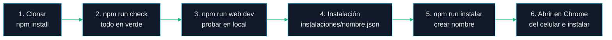

[README](../README.md) · [Empezar](INICIO.md) · [El bot](BOT.md) · [Arquitectura](ARQUITECTURA.md) · [IA](IA.md) · [Desarrollo](DESARROLLO.md) · [Ramas](RAMAS.md) · [Todas las guías](README.md)

# Guía de inicio

De cero a la app instalada en el celular. Todo corre en el plan gratuito de Cloudflare.

## Qué vas a tener

Una app donde escribes lo que pasó con tu plata y queda anotado. Cada persona o negocio tiene su propia instalación: su servidor (un Worker), su base de datos y su clave. Nada se mezcla con las de otros.



## Lo que necesitas

- Node 24 o superior y Git.
- Una cuenta gratuita de Cloudflare (ver [GUIA-CUENTAS.md](GUIA-CUENTAS.md)).

> [!NOTE]
> No hace falta dominio ni tarjeta. Todo corre en el plan gratuito.

## 1. Bajar el código y comprobar

```bash
git clone https://github.com/DVLASZ/finanzas.git finanzas
cd finanzas
npm install
npm run check
```

> [!TIP]
> Todo debe pasar. Si algo falla, no sigas: es mejor saberlo ahora.

## 2. Probar en tu computador

```bash
npm run web:dev
```

Abre la dirección que imprime. Sin servidor, la app guarda en el navegador y el chat entiende los mensajes igual. Sirve para conocerla antes de publicar nada.

## 3. Crear tu instalación

1. Copia `scripts/instalacion-ejemplo.json` a `instalaciones/<nombre>.json`. La carpeta `instalaciones/` no se sube a git.
2. Edítalo. Lo importante es `plantilla` (`personal`, `familia` o `empresa`), `worker` y `base` (el nombre que quieras, solo minúsculas, números y guiones), `nombreApp` y las personas con las que quieras empezar. Para el aspecto: `piel` (`libro` o `tierra`), `tema` (`claro`, `oscuro` o `auto`) y `letra` (`normal` o `grande`).
3. Entra a Cloudflare una vez con `npx wrangler login`.
4. Crea todo:

```bash
npm run instalar -- crear <nombre>
```

Te va pidiendo confirmación en cada paso. Crea la base, la llena con las cuentas y categorías de la plantilla, genera una clave y un PIN, y publica. Al final te da la dirección de la app y guarda la clave y el PIN en `instalaciones/<nombre>/acceso.txt`. Guárdalos en un gestor de contraseñas.

Para publicar de nuevo después de cambiar algo: `npm run instalar -- publicar <nombre>`.

> [!WARNING]
> La clave y el PIN no se pegan en chats ni se suben a git.

## 4. Instalar en el celular

1. Abre la dirección de la app en Chrome del celular.
2. Entra a Más, Ajustes, y pega la clave. La dirección del servidor ya viene puesta.
3. En el menú de Chrome (los tres puntos) elige Instalar app.

> [!IMPORTANT]
> Instala desde Chrome. Si solo ves Añadir a la pantalla de inicio, es un acceso directo y no la app completa. Brave, Firefox y otros navegadores abren la app, pero no la instalan completa: sin accesos directos en el ícono y sin recibir imágenes con Compartir.
4. Ábrela desde el ícono y prueba con `mecato 5000`. Pulsa Confirmar.
5. Para ver que funciona sin internet, pon el celular en modo avión, anota un gasto y quita el modo avión. Se sincroniza solo.

Si una persona tiene dos apps (una personal y una de su negocio), se instala cada una por separado. Son direcciones distintas, con nombre e ícono distintos, y cada una pide su propia clave.

## 5. Los primeros pasos dentro de la app

- Dile cuánta plata tienes: `saldo inicial efectivo 85000 monedas 12000` (usa las cuentas que tenga tu app).
- Escribe `ayuda` o pulsa el botón Ayuda del chat: te pregunta de qué quieres saber y trae un recorrido de cuatro pasos para empezar. Cada ejemplo tiene un botón «Probar en el chat».
- Si tienes un PIN, en Ajustes puedes pedir que la app se bloquee al pasar a segundo plano o tras 2 o 5 minutos, y hacer un respaldo con contraseña.
- Las cifras arrancan escondidas (`••••••`). Toca el ojo de Saldos o de Resumen para verlas, o apaga el interruptor en Ajustes.
- En Más, Ajustes, activa los avisos del celular si quieres (ver [AVISOS.md](AVISOS.md)).
- Si quieres leer comprobantes con la cámara, la primera vez Cloudflare pide aceptar una licencia de Meta, una sola vez por cuenta. Ver [IA.md](IA.md).

## Si algo falla

<details>
<summary>Problemas frecuentes</summary>

- Dice "No autorizado": la clave de Ajustes no es la de `acceso.txt`.
- La app no se actualiza: ciérrala y ábrela otra vez con internet. Baja la versión nueva sola.
- En PowerShell, si dice que los scripts están deshabilitados, usa `npm.cmd` y `npx.cmd`, o abre CMD.

</details>

