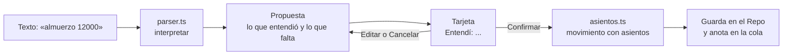
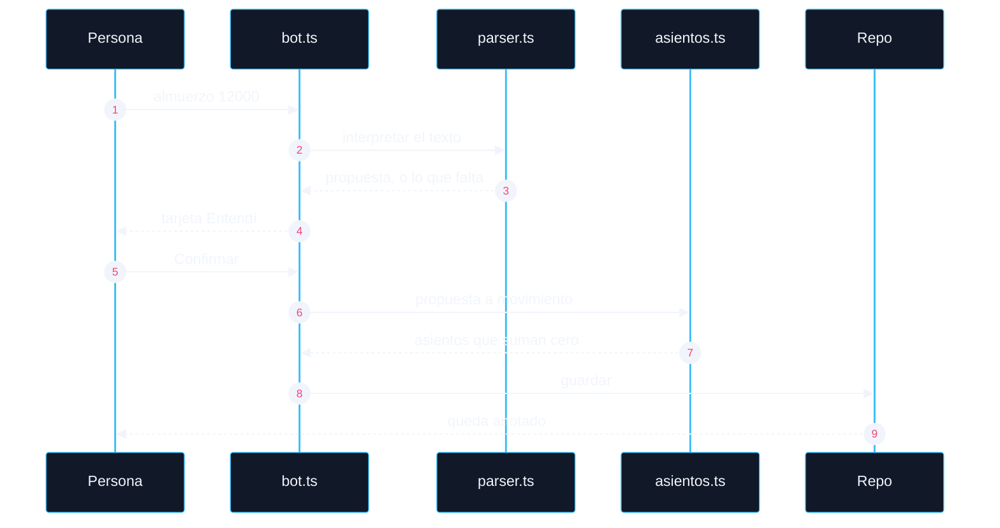

[README](../README.md) · [Empezar](INICIO.md) · [El bot](BOT.md) · [Arquitectura](ARQUITECTURA.md) · [IA](IA.md) · [Desarrollo](DESARROLLO.md) · [Ramas](RAMAS.md) · [Todas las guías](README.md)

# Motor contable

Todo el trabajo de entender un mensaje y convertirlo en plata que cuadra vive en `packages/core`. No depende de ninguna plataforma: lo usa el navegador (dentro de la app), el Worker y las pruebas. Este documento cuenta el camino de un mensaje; las tablas y las reglas de la partida doble están en [MODELO-DATOS.md](MODELO-DATOS.md).

## El camino de un mensaje





1. `parser.ts` limpia el texto, reconoce montos, fechas, cuentas, personas y categorías, y arma una propuesta. Si algo falta (una categoría, con cuánto pagó), la propuesta lo dice y el bot pregunta con botones.
2. `bot.ts` muestra la tarjeta «Entendí». Nada se guarda todavía.
3. Al confirmar, `asientos.ts` convierte la propuesta en un movimiento con asientos que suman cero por moneda. Si no suman cero, no se guarda.
4. El movimiento pasa al `Repo` y, en la app, a la cola de sincronización.

## La partida doble en una línea

> [!NOTE]
> Si los asientos de un movimiento no suman cero por moneda, no se guarda. Esa es la única regla que sostiene todo lo demás.

Cada movimiento mueve plata entre cuentas y sus asientos suman cero. Un gasto resta de una cuenta de dinero y suma a una categoría; un préstamo resta de dinero y suma a una persona. No hay casos especiales: gastos, ingresos, deudas, ventas y cambios de moneda son el mismo modelo con otras cuentas.

## Módulos que calculan

| Módulo | Qué calcula |
|---|---|
| `consultas.ts` | Saldos, gasto por categoría, ingresos por fuente, deudas y topes. |
| `seguro.ts` | El «seguro para gastar hoy»: disponible, menos la plata de otros, menos los pagos fijos que faltan, menos lo apartado en alcancías, repartido entre los días que quedan del mes. Nunca da negativo. El tope del día se fija con lo libre más lo gastado hoy, así que «te queda hoy» es ese tope menos lo gastado, sin descontarlo dos veces. Lo gastado hoy es solo tu parte de gastos y compartidos que sacaron plata de tus cuentas: ni deudas ni cuadres. También calcula `patrimonio`: Neto = todo lo que tienes (disponible sin la plata de otros, más monedas y alcancía) más lo que te deben, menos lo que debes. |
| `hormiga.ts` | Gastos hormiga: compras de 15.000 o menos que se repiten tres veces o más, agrupadas por concepto, con la proyección a un año sobre los días que ya pasaron del periodo (`diasTranscurridos`), no sobre el mes entero. |
| `recurrentes.ts`, `liquidez.ts` | `fechasQueFaltan` decide qué pagos fijos siguen sin pagar (comparando sin tildes ni mayúsculas) y lo usan el seguro y los próximos 30 días. Un pago ya hecho este periodo no se resta; uno vencido y sin anotar sí. |
| `metas.ts` | Alcancías: lo apartado y los aportes con fecha. Con ellos estima cuántos días faltan al ritmo de los últimos 60. |
| `recurrentes.ts` | Pagos fijos de cada mes y cuáles faltan por registrar. |
| `alertas.ts`, `revision.ts` | Qué conviene avisar y qué revisar al cerrar el mes. |
| `ocr.ts` | Lee la respuesta de la IA con visión, aunque venga rodeada de texto, y la convierte en la frase que el bot entiende. |
| `ia.ts` | Instrucciones y tope diario de la ayuda de la IA para frases sueltas. |

## Por qué así

- **El bot es una librería.** Corre en el navegador, así que la app funciona sin internet y no hay dos formas de entender un mensaje.
- **Funciones puras.** Los cálculos reciben los datos y la hora y devuelven un resultado. Por eso se prueban sin base ni red.
- **La IA propone, la persona confirma.** Ni la ayuda de frases ni la lectura de comprobantes guardan nada: producen una frase que pasa por la tarjeta.
- **Lo que no se sabe no se inventa.** Un gasto sin categoría pregunta; un comprobante que no se lee devuelve un error claro; los dólares no se convierten a pesos solos.

## Pruebas

Cada archivo de `packages/core/test/` prueba un tema. Para que el bot entienda algo nuevo, se escribe primero la prueba en `bot.test.ts`. Los ejemplos de [BOT.md](BOT.md) se ejecutan solos en `docs.test.ts`: si el bot cambia y el documento no, falla. Los cálculos nuevos (seguro para gastar, hormiga, metas, lectura de comprobantes) están en `nuevas.test.ts`.

```bash
npm test
```
