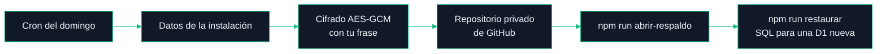

[README](../README.md) · [Empezar](INICIO.md) · [El bot](BOT.md) · [Arquitectura](ARQUITECTURA.md) · [IA](IA.md) · [Desarrollo](DESARROLLO.md) · [Ramas](RAMAS.md) · [Todas las guías](README.md)

# Copia de seguridad en la nube

> [!NOTE]
> Cada domingo el servidor sube una copia de los datos de la instalación a un repositorio privado de GitHub. Va cifrada: sin la frase que tú eliges, el archivo no se puede leer ni en GitHub. Es gratis y queda fuera de Cloudflare, así que protege también si se pierde la cuenta.

Está apagada hasta que pongas las cuatro claves (`RESPALDO_TOKEN`, `RESPALDO_REPO`, `RESPALDO_CLAVE` y `RESPALDO_NOMBRE`). Cloudflare también guarda 30 días de historia de cada base (Time Travel), que cubre un error de hace unos días. Esto cubre lo demás.



## Cómo activarla

1. En GitHub crea un repositorio **privado**, por ejemplo `respaldos-privados`, vacío.
2. Crea un token con acceso solo a ese repositorio: Settings, Developer settings, Fine-grained tokens, permiso Contents en lectura y escritura.
3. Elige una frase larga (mínimo 12 letras) y guárdala en un lugar seguro. Si la pierdes, los respaldos no se pueden abrir.
4. En tu terminal, para cada instalación (cambia `familia` por el nombre). Wrangler te pide el valor y no se muestra:

```bash
npx wrangler secret put RESPALDO_TOKEN --config instalaciones/familia/wrangler.toml
npx wrangler secret put RESPALDO_REPO --config instalaciones/familia/wrangler.toml
npx wrangler secret put RESPALDO_CLAVE --config instalaciones/familia/wrangler.toml
npx wrangler secret put RESPALDO_NOMBRE --config instalaciones/familia/wrangler.toml
```

`RESPALDO_REPO` es `tu-usuario/respaldos-privados`. `RESPALDO_NOMBRE` es la carpeta donde queda (por ejemplo `familia`); sirve para tener las tres instalaciones en el mismo repositorio. Nunca pegues estos valores en un chat.

5. Para probar sin esperar al domingo, desde la app o con la API: `POST /api/respaldo/probar` con el token de la instalación. Responde si salió bien, sin mostrar claves.

## Abrir un respaldo

Baja el archivo `carpeta/AAAA-MM-DD.json.cifrado` del repositorio y, en tu PC:

```powershell
$env:RESPALDO_CLAVE = "tu frase"
npm run abrir-respaldo -- familia/2026-11-08.json.cifrado
```

Queda un `.json` con las cuentas, los movimientos, las deudas y la configuración. > [!WARNING]
> Ese archivo ya no está cifrado: bórralo cuando termines. Está en una carpeta que git ignora si lo dejas dentro de `importacion/`.

## Restaurar en una base nueva

Si hay que volver a empezar (se perdió la base o se dañó), el respaldo se convierte en un SQL que se corre en una base D1 nueva. Está probado de punta a punta: una prueba respalda, cifra, abre, restaura en una base vacía y compara que todo sea idéntico.

1. Abre el respaldo como se explicó arriba (queda un `.json`).
2. Genera el SQL:

```powershell
npm run restaurar -- importacion/familia-2026-11-08.json importacion/restaurar-familia.sql
```

3. Crea la base nueva, ponle el esquema y el SQL (cambia los nombres):

```powershell
npx wrangler d1 create finanzas-familia-nueva
npx wrangler d1 execute finanzas-familia-nueva --remote --file db/schema.sql
npx wrangler d1 execute finanzas-familia-nueva --remote --file importacion/restaurar-familia.sql
```

4. Apunta el Worker a la base nueva (el `database_id` en `instalaciones/familia/wrangler.toml`) y publica con `npm run instalar -- publicar familia --si`.

> [!NOTE]
> Lo que no vuelve con el respaldo: las fotos de recibos, las suscripciones de avisos (cada celular tiene que volver a activarlos) y los secretos (tokens), que se ponen otra vez con `wrangler secret put`.

## Respaldo con contraseña desde la app

Ajustes, «Respaldo con contraseña», baja un archivo cifrado en el navegador: PBKDF2 con SHA-256 (600.000 vueltas) saca la clave de tu contraseña y AES-GCM de 256 bits cifra el contenido, con sal y vector propios en cada archivo. AES-GCM además avisa si alguien tocó el archivo. La contraseña no se guarda en ninguna parte: si la pierdes, el respaldo no se puede abrir. Mínimo 8 caracteres. «Restaurar respaldo» reconoce solo si el archivo está cifrado y pide la contraseña; los respaldos de antes, sin cifrar, siguen funcionando. Es independiente del respaldo semanal a GitHub de arriba. Código: `apps/web/src/services/cifrado.ts`.

## Cómo está hecho

`apps/worker/src/respaldo.ts`. Cifra con AES-GCM de 256 bits; la llave sale de tu frase con PBKDF2 (100.000 vueltas, el máximo que deja Cloudflare, y una sal distinta en cada archivo). Cada día tiene su archivo: si el domingo se repite, no duplica. Las claves de avisos (`secreto_`) nunca entran al respaldo. Las fotos de recibos tampoco: viven en su propia tabla y pesan.
